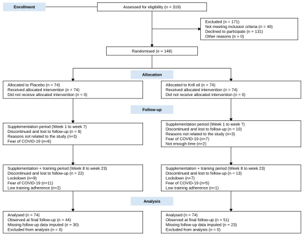
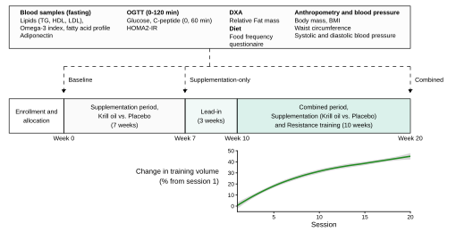
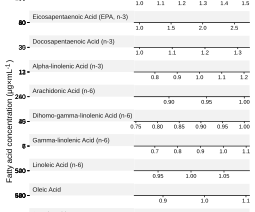

```{r}
#| label: setup
#| echo: false


```


## Data analysis and statistics

Descriptive data are presented as mean and standard deviation (SD).
For inferential statistics, Bayesian models were constructed using the Stan 
probabilistic programming language [@stanpaper] and fitted using the `cmdstanr` interface [@cmdstanr] in R [@R].
All sampling from prior and posterior distributions was done using the Hamiltonian Monte Carlo (HMC) no-U-turn sampler [@stanref].
Performance of the HMC algorithm was assessed using chain convergence statistics (R-hat) and by visually inspecting convergence and stationary sampling across multiple HMC chains.
A general workflow was adopted where models were incrementally built and tested for validity through simulations.
First, implications of prior distributions were evaluated using prior-predictive simulations.
Priors were selected to constrain model predictions and parameter values to *a priori* plausible ranges.
This approach encourages the use of weakly informative priors on model parameters, which regularize models and shrink estimates and predictions without distorting the influence of the data on inference [@lemoine2019;@mcelreath2020;@gelman2014].
In relevant cases, synthetic data were used to confirm that model inferences were not biased by model misspecification.
Samples from the joint posterior distribution were used to create posterior predictive simulations, in which model implications are simulated and compared with characteristics of the observed data [@gelman2014, pp. 141].
Selected models were also assessed for inferential capabilities using synthetic data simulations where parameter values are known. The sensitivity of model specifications to inference was assessed by comparing predictions across different models.

Missing values were imputed in all models used for inference allowing for the use of all available data while incorporating the uncertainty associated with loss of data due to drop-out (see Fig. 1) into the posterior probability distribution.
We therefore consider the inferential analyses to be intention-to-treat.
Data imputation was done by treating missing values as parameters estimated conditionally on available data and priors [@gelman2014, pp. 449-].
Missing data parameters were given a weakly informative prior ($\operatorname{Normal}(0,2)$) on the standardized scale (mean centered and scaled by the standard deviation of each variable).

Red blood cell fatty acid composition and the omega-3 index were modeled for each target ($k = 1, \dots, K$; $K = 13$) using a Gaussian likelihood after log-transformation (fatty acids only) and standardization of the outcome variables ($y_i \sim \operatorname{Normal}(\mu_i, \sigma_{\text{FA}[i], \text{TX}[i]})$, where $\text{FA}[i] \in \{1, \dots, K\}$, $\text{TI}[i]$, and $\text{TX}[i]$ index the target, follow-up time-point and treatment of observation $i$).
The linear predictor included a target-, treatment- and time-point-specific intercept and a target-specific coefficient for the association with pre-intervention values ($\mu_i = \alpha_{\text{FA}[i],\text{TI}[i],\text{TX}[i]} + \beta_{\text{FA}[i]} \times \text{Pre}_i$, where $\text{Pre}_i$ is the standardized pre-intervention value of the same target and participant).
Priors were common to all targets
($\alpha \sim \operatorname{Normal}(0, 1)$,
$\beta \sim \operatorname{Normal}(1, 1)$,
and $\sigma \sim \operatorname{Exponential}(1)$).
Treatment effects were assessed by calculating the contrast between treatments at each follow-up time-point.

Blood glucose measured during the oral glucose tolerance test (OGTT) was modeled using a Gaussian likelihood after standardization ($y_i \sim \operatorname{Normal}(\mu_i, \sigma)$).
Glucose curves were represented by a cubic B-spline basis with $J = 5$ basis functions (5 degrees of freedom, no intercept column; `bs()` from the `splines` package), where $B_{j,i}$ is the $j$-th basis function evaluated at the sampling time (min) of observation $i$.
A population-level curve was estimated for each combination of treatment ($\text{TX}[i]$) and time-point ($\text{TP}[i] \in \{1, 2, 3\}$; baseline, after the supplementation-only period, and after the intervention), with participant-level deviations from the population-level curve:
$\mu_i = \alpha_{\text{TX}[i],\text{TP}[i]} + \sum_{j=1}^{J} \beta_{j,\text{TX}[i],\text{TP}[i]} B_{j,i} + a_{\text{ID}[i]} + \delta_{\text{TP}[i],\text{ID}[i]} + \sum_{j=1}^{J} b_{j,\text{TP}[i],\text{ID}[i]} B_{j,i}$,
where $\alpha$ and $\beta$ are treatment- and time-point-specific intercepts and spline parameters, $a$ is a participant-specific intercept, $\delta$ are participant- and time-point-specific deviations from that intercept, and $b$ are participant- and time-point-specific spline deviations ($\text{ID}[i]$ indexes the participant of observation $i$).
The participant-specific intercept and spline deviations ($1 + 3J$ effects per participant) were drawn from a multivariate normal distribution ($\operatorname{MVNormal}(\mathbf 0, \mathbf{S R S})$, $\mathbf S = \operatorname{diag}(\sigma_{\text{ID}})$), with an $\text{LKJ}(1)$ prior on the correlation matrix $\mathbf R$ (non-centered parameterization via its Cholesky factor).
Time-point-specific intercept deviations were modeled as independent, $\delta_{t,\text{ID}} \sim \operatorname{Normal}(0, \tau_\delta)$, with $\tau_\delta \sim \operatorname{Exponential}(2)$ regularizing the model towards a common participant intercept across time-points.
Remaining priors were $\alpha, \beta \sim \operatorname{Normal}(0, 2)$ and $\sigma, \sigma_{\text{ID}} \sim \operatorname{Exponential}(1)$, and missing OGTT values were imputed as described above.
Treatment effects were assessed as between-group differences in the change from baseline of posterior predicted population-level curves, evaluated across the sampling time.


```{r}
#| label: model-comp-s13
#| echo: false
#| message: false

# LOO comparison of the multivariate (s13, MVT with full correlation) and the
# univariate counterpart (s18, univariate t, same time x type scales).
# Both export a complete-case, participant-level log_lik (summed over all
# outcomes and follow-up time-points), so elpd is comparable between models
# (leave-one-participant-out). loo objects are saved when the models are fitted
# (see 07-metsyn-inference.qmd).
library(loo)

loo.s13 <- readRDS("fits/paper1/loo_s13.RDS")
loo.s18 <- readRDS("fits/paper1/loo_s18.RDS")

loo_comp_s13 <- loo_compare(list("s13" = loo.s13, "s18" = loo.s18))

# Summary table (elpd and p_loo per model, difference vs. the best model,
# and number of participants with Pareto k > 0.7)
loo_tab_s13 <- data.frame(
  model     = rownames(loo_comp_s13),
  elpd_loo  = loo_comp_s13[, "elpd_loo"],
  se_elpd   = loo_comp_s13[, "se_elpd_loo"],
  p_loo     = loo_comp_s13[, "p_loo"],
  elpd_diff = loo_comp_s13[, "elpd_diff"],
  se_diff   = loo_comp_s13[, "se_diff"]
)
loo_tab_s13$n_high_k <- sapply(list(s13 = loo.s13, s18 = loo.s18)[loo_tab_s13$model],
                               function(x) sum(x$diagnostics$pareto_k > 0.7))

# Values for in-line reporting
loo_n_part   <- nrow(loo.s13$pointwise)
loo_diff_s18 <- loo_comp_s13["s18", "elpd_diff"]
loo_se_s18   <- loo_comp_s13["s18", "se_diff"]
loo_diff_txt <- sprintf("%.1f (SE %.1f)", loo_diff_s18, loo_se_s18)

```


Metabolic syndrome criteria measures [@alberti2006] (waist circumference, systolic and diastolic blood pressure, fasting glucose, high-density lipoprotein cholesterol (HDL) and triglycerides (TG)) and related measures of metabolic health (relative fat mass, body mass index, HOMA2-IR, adiponectin, glycated haemoglobin (HbA1c) and low-density lipoprotein cholesterol (LDL)) were jointly modeled in a multivariate model ($K = 12$ outcomes).
The reason for choosing this model over several univariate models was twofold: first, we wanted to improve the accuracy of imputed outcome values by sharing information across outcomes, allowing for more realistic estimation of the metabolic syndrome diagnostic criteria; second, we wanted to combine information from several outcome variables into a composite score while accounting for their correlations.
Triglycerides and HOMA2-IR were log-transformed, and all outcomes were standardized.
The linear predictor for observation $i$ was $\mu_i = \alpha_{\text{OC}[i],\text{TI}[i],\text{TX}[i]} + \beta_{\text{OC}[i],\text{TI}[i]} \times \text{Pre}_i + \gamma_{\text{OC}[i],\text{TI}[i]} \times \text{Sex}_i$, where $\text{OC}[i] \in \{1, \dots, K\}$, $\text{TI}[i]$ and $\text{TX}[i]$ index the outcome, follow-up time-point and treatment of observation $i$, $\text{Pre}_i$ is the standardized pre-intervention value of the same outcome and participant, and $\text{Sex}_i$ was coded as $-0.5$ (male) and $0.5$ (female).
For each participant ($p$), observations and linear predictors of all outcomes at both follow-up time-points were stacked in vectors $\mathbf y_p$ and $\boldsymbol\mu_p$ of length $2K$, modeled using a multivariate Student's *t*-distribution, $\mathbf y_p \sim \operatorname{MVT}(\nu, \boldsymbol\mu_p, \boldsymbol\Sigma)$, with the degrees of freedom fixed at $\nu = 4$ to reduce the influence of outlying observations.
The scale matrix was parameterized as $\boldsymbol\Sigma = \operatorname{diag}(\boldsymbol\sigma)\,\boldsymbol\Omega\,\operatorname{diag}(\boldsymbol\sigma)$, with outcome- and time-point-specific scales ($\boldsymbol\sigma$) and a $2K \times 2K$ correlation matrix ($\boldsymbol\Omega$) capturing correlations between outcomes and between time-points.
Missing pre-intervention values were imputed using a multivariate normal model of pre-intervention values ($\operatorname{MVNormal}(\boldsymbol\mu_{\text{pre}}, \boldsymbol\Sigma_{\text{pre}})$).
Priors were $\alpha \sim \operatorname{Normal}(0, 1)$, $\beta \sim \operatorname{Normal}(1, 0.4)$, $\gamma \sim \operatorname{Normal}(0, 0.5)$, $\boldsymbol\sigma, \boldsymbol\sigma_{\text{pre}} \sim \operatorname{Exponential}(1)$, $\boldsymbol\mu_{\text{pre}} \sim \operatorname{Normal}(0, 1)$, $\boldsymbol\Omega \sim \operatorname{LKJ}(4)$ and $\boldsymbol\Omega_{\text{pre}} \sim \operatorname{LKJ}(2)$.
Comparing the multivariate model to an univariate version of the same model (shared mean and variance structure but without the between-outcomes correlation structure) indicated that the multivariate model had a better out-of-sample predictive performance  (&delta; expected log point-wise predictive density `r loo_diff_txt`; leave-one-out cross-validation [@vehtari2017] on the level of participant for `r loo_n_part` complete cases). This difference between the two models indicate that the correlation structure brings information that benefit prediction. Assuming that missing values are missing at random, the multivariate model is expected to provide more realistic imputation estimates.  
Treatment effects on each outcome ($k$) were assessed as the contrast between treatments ($\alpha_{k,t,\text{Krill-oil}} - \alpha_{k,t,\text{Placebo}}$) at each follow-up time-point ($t$).
A composite metabolic syndrome burden score was calculated as the average contrast across the five diagnostic criteria (blood pressure as the average of systolic and diastolic pressure, and HDL with reversed sign), such that positive values indicate a less favorable metabolic profile in the krill-oil group.
Metabolic syndrome diagnosis was determined for each participant and time-point in every posterior draw (including imputed values), using the harmonised definition, i.e. at least three of the five criteria (sex-specific waist circumference, TG, HDL, blood pressure and fasting glucose) beyond their thresholds [@alberti2009].
Treatment effects on diagnosis were estimated by fitting logistic mixed-effects models (time &times; treatment interaction, participant-specific intercepts) to 500 posterior draws using `glmmTMB` [@brooks2017], and pooling estimates using Rubin's rules [@rubin1987].

To assess whether treatment effects depended on participants' metabolic status at baseline, the multivariate model was extended in two ways.
First, the treatment effect on each outcome was allowed to depend on the baseline value of the same outcome by adding $\delta_{\text{OC}[i],\text{TI}[i]} \times \text{KO}_i \times \text{Pre}_i$ to the linear predictor, where $\text{KO}_i$ is 1 for krill oil and 0 for placebo.
Second, the treatment effect on all outcomes was allowed to depend on a baseline metabolic syndrome burden score by adding $\gamma_{\text{OC}[i],\text{TI}[i]} \times \text{KO}_i \times \tilde{b}_{\text{ID}[i]}$, where $\tilde{b}$ is the mean-centered average of the standardized baseline values of the five diagnostic criteria (HDL with reversed sign, and blood pressure as the average of systolic and diastolic pressure), calculated from observed and imputed baseline values.
Interaction parameters were given hierarchical priors that shrink them towards zero unless supported by the data ($\delta = \tau_\delta z$, $z \sim \operatorname{Normal}(0, 1)$, $\tau_\delta \sim \operatorname{Half-Normal}(0, 0.25)$, and correspondingly for $\gamma$).
In both models, average treatment effects in participants with and without the metabolic syndrome at baseline were calculated by averaging participant-specific treatment effects within each subgroup in every posterior draw, thereby including the uncertainty of imputed baseline values and baseline diagnoses.
Predictive performance of the extended models was compared with the main model using leave-one-participant-out cross-validation (PSIS-LOO).


  


## Results


### Participants and baseline characteristics


```{r}
#| label: results-n-participants
#| echo: false
#| message: false
#| warning: false

source("./R/packages.R")
source("./R/data-prep.R") # criteria_dat, total_participants, data_load_s7s10()

# Import data set for the metabolic syndrome analysis
# (as in figures/figure-05.R, model s13). ms_dat$dat is in long format with
# one row per participant (P), follow-up time (1 = T2, 2 = T4) and outcome
# (type), y_miss/pre_miss = 1 when observed and treat = 1/2.
ms_dat <- data_load_s7s10()

# Import data set for the OGTT analysis
# (as in 08-ogtt.qmd, model mo4). One row per participant, time-point (T1, T2,
# T4) and sampling minute, glucose = NA when missing.
ogtt_dat <- AOData::glucose |>
  select(participant, time, min, glucose) |>
  inner_join(AOData::idkeys |> select(participant, treat)) |>
  filter(participant %in% unique(criteria_dat$participant)) |>
  pivot_wider(values_from = glucose, names_from = time) |>
  pivot_longer(cols = T1:T4, values_to = "glucose", names_to = "time")

# Import data set for the FA analysis
# (as in figures/figure-02.R). One row per participant, time-point and fatty
# acid (incl. the omega-3 index), value = NA when missing. Participants without
# baseline data are excluded, as in the model.
fa_dat <- AOData::omega3 |>
  inner_join(AOData::idkeys) |>
  filter(time %in% c("T1", "T2", "T4"), participant %in% total_participants) |>
  select(participant, time, treat, C16:C226n3, omega3index) |>
  pivot_longer(cols = c(C16:C226n3, omega3index), names_to = "fa", values_to = "value") |>
  pivot_wider(names_from = time, values_from = value) |>
  filter(!is.na(T1)) |>
  pivot_longer(cols = T1:T4, names_to = "time", values_to = "value")

# Calculate number of participants
n_part <- ogtt_dat |> 
  distinct(participant, treat) |> 
  summarise(.by = treat, 
            n = n())

total_n <- sum(n_part$n)
n_part_ls <- with(n_part, setNames(as.list(n), treat))

# Number completed the intervention
completers_ls <- AOData::idkeys |> 
  filter(completed == "t4") |> 
  distinct(participant, treat) |> 
  summarise(.by = treat, 
            n = n()) |> 
  with(setNames(as.list(n), treat))


```


```{r}
#| label: tbl-table-01
#| tbl-cap: "Baseline characteristics of participants. Data are mean (SD) or n (%)."
#| echo: false
#| message: false
#| warning: false

# Participants included in the analyses (as above)
tab_ids <- unique(ogtt_dat$participant)

# Baseline (T1) values in natural units, one row per participant and variable
base_long <- bind_rows(
  # Age, height, weight and BMI
  baseline_dat |>
    select(participant, name, value),
  # Metabolic syndrome criteria and related measures
  criteria_dat |>
    filter(time == "T1", analyte != "bmi") |>
    select(participant, name = analyte, value),
  # Omega-3 index
  fa_dat |>
    filter(time == "T1", fa == "omega3index") |>
    select(participant, name = fa, value)
) |>
  filter(participant %in% tab_ids, !is.na(value)) |>
  inner_join(AOData::idkeys |> select(participant, treat, sex))

# Baseline metabolic syndrome diagnosis (observed data, harmonized criteria):
# central obesity (waist) and >= 2 of TG, HDL, BP (systolic or diastolic) and
# glucose. Only participants with all criteria measured at baseline.
base_metsyn <- criteria_dat |>
  filter(time == "T1", participant %in% tab_ids,
         analyte %in% c("waist", "HDL", "TG", "glucose", "sys", "dias")) |>
  select(participant, treat, analyte, crit) |>
  pivot_wider(names_from = analyte, values_from = crit) |>
  filter(complete.cases(pick(waist, HDL, TG, glucose, sys, dias))) |>
  mutate(bp = pmax(sys, dias),
         metsyn = as.numeric(waist == 1 & (HDL + TG + glucose + bp) >= 2))

# Binary characteristics per participant
base_bin <- base_long |>
  filter(name == "bmi") |>
  transmute(participant, treat, obesity = as.numeric(value >= 30)) |>
  full_join(base_metsyn |> select(participant, treat, metsyn),
            by = c("participant", "treat")) |>
  full_join(AOData::idkeys |>
              filter(participant %in% tab_ids) |>
              transmute(participant, treat, female = as.numeric(sex == "f")),
            by = c("participant", "treat"))

# Summaries per treatment group and total
summ_cont <- function(d) {
  d |>
    summarise(.by = name,
              txt = sprintf("%.1f (%.1f)", mean(value), sd(value)),
              n = n())
}

summ_bin <- function(d) {
  d |>
    pivot_longer(c(obesity, metsyn, female)) |>
    filter(!is.na(value)) |>
    summarise(.by = name,
              txt = sprintf("%d (%.0f%%)", sum(value), 100 * mean(value)),
              n = n())
}

tab1 <- bind_rows(
  bind_rows(summ_cont(base_long), summ_bin(base_bin)) |> mutate(group = "Total"),
  bind_rows(summ_cont(filter(base_long, treat == "ctrl")),
            summ_bin(filter(base_bin, treat == "ctrl"))) |> mutate(group = "Placebo"),
  bind_rows(summ_cont(filter(base_long, treat == "omega")),
            summ_bin(filter(base_bin, treat == "omega"))) |> mutate(group = "Krill oil")
)

# Variable labels and order
tab1_labels <- c(
  female      = "Female, n (%)",
  age         = "Age (years)",
  height      = "Height (cm)",
  weight      = "Body mass (kg)",
  bmi         = "Body mass index (kg m^-2^)",
  obesity     = "Obesity (BMI ≥ 30), n (%)",
  fat.rel     = "Relative fat mass (%)",
  waist       = "Waist circumference (cm)",
  sys         = "Systolic blood pressure (mmHg)",
  dias        = "Diastolic blood pressure (mmHg)",
  glucose     = "Fasting glucose (mmol L^-1^)",
  HDL         = "HDL cholesterol (mmol L^-1^)",
  LDL         = "LDL cholesterol (mmol L^-1^)",
  TG          = "Triglycerides (mmol L^-1^)",
  HOMA2IR     = "HOMA2-IR",
  Adiponectin = "Adiponectin (mg L^-1^)",
  omega3index = "Omega-3 index (%)",
  metsyn      = "Metabolic syndrome, n (%)"
)

tab1 |>
  select(name, group, txt) |>
  pivot_wider(names_from = group, values_from = txt) |>
  # Number of participants with data (total) per variable
  left_join(tab1 |> filter(group == "Total") |> select(name, n), by = "name") |>
  filter(name %in% names(tab1_labels)) |>
  mutate(name = factor(name, levels = names(tab1_labels), labels = tab1_labels)) |>
  arrange(name) |>
  select(name, n, Placebo, `Krill oil`, Total) |>
  # Markdown table, rendered as a native Word table by pandoc
  knitr::kable(
    col.names = c("",
                  "n",
                  sprintf("Placebo (n = %d)", n_part_ls$ctrl),
                  sprintf("Krill oil (n = %d)", n_part_ls$omega),
                  sprintf("Total (n = %d)", total_n)),
    align = "lcccc"
  )


# Values for in-line reporting
bmi_range <- base_long |>
  filter(name == "bmi") |>
  summarise(min = min(value), max = max(value))

pct_by <- function(d, var) {
  out <- d |>
    filter(!is.na(.data[[var]])) |>
    summarise(.by = treat, p = 100 * mean(.data[[var]]))
  c(as.list(setNames(sprintf("%.0f", out$p), out$treat)),
    total = sprintf("%.0f", 100 * mean(d[[var]], na.rm = TRUE)))
}

obesity_pct <- pct_by(base_bin, "obesity")
metsyn_pct  <- pct_by(base_bin, "metsyn")
metsyn_n    <- sum(!is.na(base_bin$metsyn))
```


Of the `r total_n` randomized participants (placebo, n = `r n_part_ls$ctrl`; krill oil, n = `r n_part_ls$omega`), 95 completed the intervention (placebo, n = `r completers_ls$ctrl`; krill oil, n = `r completers_ls$omega`). Discontinuation was mainly related to the COVID-19 pandemic (45 of 56 participants), and all randomized participants were included in the analyses (Fig. 1). At baseline, participant characteristics were similar between arms (Table 1). BMI ranged from `r sprintf("%.1f", bmi_range$min)` to `r sprintf("%.1f", bmi_range$max)` kg m^-2^, and `r obesity_pct$total` % of participants had obesity (BMI ≥ 30 kg m^-2^; placebo, `r obesity_pct$ctrl` %; krill oil, `r obesity_pct$omega` %). Of `r metsyn_n` participants with all diagnostic criteria measured at baseline, `r metsyn_pct$total` % met the harmonized criteria for the metabolic syndrome (placebo, `r metsyn_pct$ctrl` %; krill oil, `r metsyn_pct$omega` %). Energy and macronutrient intakes were similar between arms and did not change meaningfully during the intervention (Table 2). 


### Intervention efficacy

```{r}
#| label: results-fa
#| echo: false
#| message: false
#| warning: false

# Estimates from the fatty acid model (m4, as in figures/figure-02.R). The model
# is fitted to log-transformed, standardized values, with FA indexed
# alphabetically (dense_rank(fa)), TI = 1 (T2), 2 (T4) and TX = 1 (ctrl),
# 2 (omega).
fit.m4p <- readRDS("fits/paper1/fit.m4p.RDS")

# Scale parameters used for standardization (log scale, all time-points)
fa_scale <- fa_dat |>
  summarise(.by = fa,
            m = mean(log(value), na.rm = TRUE),
            s = sd(log(value), na.rm = TRUE)) |>
  mutate(FA = dense_rank(fa))

# Mean standardized baseline value per FA (predictions at average baseline)
fa_pre <- fa_dat |>
  filter(time == "T1") |>
  inner_join(fa_scale, by = "fa") |>
  summarise(.by = FA, pre = mean((log(value) - m) / s))

# Posterior predicted means (natural scale) per FA, time-point and treatment
fa_beta <- fit.m4p$draws("beta", format = "df") |>
  as_tibble() |>
  pivot_longer(starts_with("beta"), names_to = "par", values_to = "beta") |>
  mutate(FA = as.integer(gsub("beta\\[(\\d+)\\]", "\\1", par))) |>
  select(.draw, FA, beta)

fa_draws <- fit.m4p$draws("alpha", format = "df") |>
  as_tibble() |>
  pivot_longer(starts_with("alpha"), names_to = "par", values_to = "alpha") |>
  mutate(FA = as.integer(gsub("alpha\\[(\\d+),(\\d+),(\\d+)\\]", "\\1", par)),
         TI = as.integer(gsub("alpha\\[(\\d+),(\\d+),(\\d+)\\]", "\\2", par)),
         TX = as.integer(gsub("alpha\\[(\\d+),(\\d+),(\\d+)\\]", "\\3", par))) |>
  select(.draw, FA, TI, TX, alpha) |>
  inner_join(fa_beta, by = c(".draw", "FA")) |>
  inner_join(fa_pre, by = "FA") |>
  inner_join(fa_scale, by = "FA") |>
  mutate(mu = exp(m + s * (alpha + beta * pre)),
         treat = if_else(TX == 1, "ctrl", "omega"),
         time = if_else(TI == 1, "T2", "T4")) |>
  select(.draw, fa, time, treat, mu) |>
  pivot_wider(names_from = treat, values_from = mu) |>
  # Relative (%) and absolute differences, krill oil vs. placebo
  mutate(rel = 100 * (omega / ctrl - 1),
         abs = omega - ctrl)

# Summaries: posterior mean and 95% credible interval
fa_est <- fa_draws |>
  pivot_longer(c(ctrl, omega, rel, abs)) |>
  summarise(.by = c(fa, time, name),
            est = mean(value),
            lwr = quantile(value, 0.025),
            upr = quantile(value, 0.975))

# Observed baseline geometric means per group (as in figures/figure-02.R)
fa_base <- fa_dat |>
  filter(time == "T1", !is.na(value)) |>
  summarise(.by = c(fa, treat), est = exp(mean(log(value))))

# Text helpers. fa_txt("C205n3", "T2") -> "+103 % (95% CrI: 80, 128)"
# what = "rel" (% difference) or "abs" (difference on the natural scale)
fmt_num <- function(x, digits) sub("^-", "−", sprintf(paste0("%.", digits, "f"), round(x, digits) + 0))

fa_txt <- function(fa_name, tp, what = "rel", digits = 0) {
  e <- fa_est |> filter(fa == fa_name, time == tp, name == what)
  est <- fmt_num(e$est, digits)
  if (what == "rel" && e$est > 0) est <- paste0("+", est)
  unit <- if (what == "rel") " %" else ""
  paste0(est, unit, " (95% CrI: ", fmt_num(e$lwr, digits), ", ", fmt_num(e$upr, digits), ")")
}

fa_mean <- function(fa_name, tp, tx, digits = 1) {
  if (tp == "T1") {
    v <- fa_base |> filter(fa == fa_name, treat == tx) |> pull(est)
  } else {
    v <- fa_est |> filter(fa == fa_name, time == tp, name == tx) |> pull(est)
  }
  sprintf(paste0("%.", digits, "f"), v)
}
```


Krill oil substantially raised whole-blood n-3 PUFAs compared with placebo from week 0 to week 7 (supplementation alone), and the increase was sustained to week 20 (combined supplementation and resistance training; Figs. 3 and 4). EPA more than doubled (`r fa_txt("C205n3", "T2")` at week 7 and `r fa_txt("C205n3", "T4")` at week 20), and DHA increased by `r fa_txt("C226n3", "T2")` and `r fa_txt("C226n3", "T4")`, respectively (Fig. 3). This was accompanied by reductions in the n-6 PUFAs arachidonic acid (`r fa_txt("C204n6", "T2")` and `r fa_txt("C204n6", "T4")`) and dihomo-γ-linolenic acid (`r fa_txt("C203n6", "T2")` and `r fa_txt("C203n6", "T4")`). Consequently, the Omega-3 Index increased from `r fa_mean("omega3index", "T1", "omega")` % at week 0 to `r fa_mean("omega3index", "T2", "omega")` % and `r fa_mean("omega3index", "T4", "omega")` % at weeks 7 and 20 in the krill oil group, whereas it remained at `r fa_mean("omega3index", "T2", "ctrl")` % and `r fa_mean("omega3index", "T4", "ctrl")` % in the placebo group (baseline, `r fa_mean("omega3index", "T1", "ctrl")` %; difference, `r fa_txt("omega3index", "T2", "abs", 1)` and `r fa_txt("omega3index", "T4", "abs", 1)` percentage points; Fig. 4). Krill oil supplementation thus effectively increased n-3 PUFA status, with observed changes in line with or above those expected for this dose of EPA and DHA {Walker, 2019 #1476} and consistent with a previous trial of the same krill oil product {Rundblad, 2018 #114}.


### Glucose regulation 

```{r}
#| label: results-ogtt
#| echo: false
#| message: false
#| warning: false

# Estimates from the OGTT model (mo4, see 08-ogtt.qmd). Population-level curves
# per cell g (1-6 = T1ctrl, T1omega, T2ctrl, T2omega, T4ctrl, T4omega) are
# a_g[g] + B %*% b_g[, g] on the standardized scale. Posterior draws of the
# population-level parameters are cached, as the full fit is large (~1 GB).
library(splines)

ogtt_pop_file <- "data-derived/ogtt-mo4-pop-draws.RDS"

if (!file.exists(ogtt_pop_file)) {
  readRDS("fits/paper1/fit.mo4.RDS")$draws(c("a_g", "b_g"), format = "df") |>
    as_tibble() |>
    saveRDS(ogtt_pop_file)
}
ogtt_pop <- readRDS(ogtt_pop_file)

# Basis and standardization as in the model (same rows as the model data)
ogtt_B <- bs(ogtt_dat$min, df = 5)
ogtt_m <- mean(ogtt_dat$glucose, na.rm = TRUE)
ogtt_s <- sd(ogtt_dat$glucose, na.rm = TRUE)

ogtt_cells <- data.frame(g = 1:6,
                         time  = rep(c("T1", "T2", "T4"), each = 2),
                         treat = rep(c("ctrl", "omega"), times = 3))

# Predicted population-level glucose (mmol L^-1^) on a 1-min grid, per draw and cell
min_grid <- 0:120
B_grid <- predict(ogtt_B, min_grid)

ogtt_pred <- lapply(1:6, function(g) {
  a <- ogtt_pop[[sprintf("a_g[%d]", g)]]
  b <- as.matrix(ogtt_pop[, sprintf("b_g[%d,%d]", 1:5, g)])
  mu <- (matrix(a, nrow = length(a), ncol = length(min_grid)) + b %*% t(B_grid)) *
    ogtt_s + ogtt_m
  data.frame(.draw = rep(seq_along(a), times = length(min_grid)),
             min = rep(min_grid, each = length(a)),
             g = g,
             mu = as.vector(mu))
}) |>
  bind_rows() |>
  inner_join(ogtt_cells, by = "g") |>
  select(-g) |>
  pivot_wider(names_from = c(time, treat), values_from = mu)

# Within-group changes and between-group differences in change
ogtt_contr <- ogtt_pred |>
  mutate(
    # Within-group changes
    ctrl_T1_T2  = T2_ctrl - T1_ctrl,  omega_T1_T2 = T2_omega - T1_omega,
    ctrl_T2_T4  = T4_ctrl - T2_ctrl,  omega_T2_T4 = T4_omega - T2_omega,
    ctrl_T1_T4  = T4_ctrl - T1_ctrl,  omega_T1_T4 = T4_omega - T1_omega,
    # Krill oil - placebo, difference in change
    diff_T1_T2 = omega_T1_T2 - ctrl_T1_T2,
    diff_T2_T4 = omega_T2_T4 - ctrl_T2_T4,
    diff_T1_T4 = omega_T1_T4 - ctrl_T1_T4
  ) |>
  select(.draw, min, ctrl_T1_T2:diff_T1_T4)

# Average contrast (mmol L^-1^) over a window of the OGTT, i.e. the difference in
# area under the curve divided by the window length. Returns
# "-0.12 mmol L^-1^ (95% CrI: -0.40, 0.15)".
ogtt_txt <- function(contrast, from = 0, to = 120, digits = 2) {
  v <- ogtt_contr |>
    filter(min >= from, min <= to) |>
    summarise(.by = .draw, val = mean(.data[[contrast]])) |>
    pull(val)
  fmt <- function(x) sub("^-", "−", sprintf(paste0("%.", digits, "f"), round(x, digits) + 0))
  paste0(fmt(mean(v)), " mmol L^-1^ (95% CrI: ",
         fmt(quantile(v, 0.025)), ", ", fmt(quantile(v, 0.975)), ")")
}
```


Krill oil did not affect the primary outcome, the change in glucose tolerance from before to after the resistance training intervention (week 7 to week 20), compared with placebo. Throughout the OGTT, the between-group difference in blood glucose was small and uncertain (average difference in change across the OGTT, `r ogtt_txt("diff_T2_T4")`; Fig. 5A). As a secondary outcome, krill oil also did not credibly affect glucose tolerance during supplementation alone (week 0 to week 7); blood glucose between 60 and 100 min tended to be lower with krill oil than with placebo, but the difference was uncertain (average difference in change between 60 and 100 min, `r ogtt_txt("diff_T1_T2", 60, 100)`; across the OGTT, `r ogtt_txt("diff_T1_T2")`; Fig. 5A). In both groups, blood glucose during the OGTT decreased similarly from week 0 to week 20 (average change across the OGTT; placebo, `r ogtt_txt("ctrl_T1_T4")`; krill oil, `r ogtt_txt("omega_T1_T4")`; difference, `r ogtt_txt("diff_T1_T4")`; Fig. 5A, middle panels). 

```{r}
#| label: results-ms
#| echo: false
#| message: false
#| warning: false

# Estimates from the multivariate model (s13, as in figures/figure-05.R).
# alpha[time, type, treat] (time 1 = T2, 2 = T4; treat 1 = ctrl, 2 = omega)
# and beta[type, time] are on the standardized scale (log scale for TG and
# HOMA2IR). Posterior draws are cached, as the full fit is large (~0.9 GB).
ms_draws_file <- "data-derived/ms-s13-alpha-beta-draws.RDS"

if (!file.exists(ms_draws_file)) {
  readRDS("fits/paper1/fit.s13.post.RDS")$draws(c("alpha", "beta"), format = "df") |>
    as_tibble() |>
    saveRDS(ms_draws_file)
}
ms_draws <- readRDS(ms_draws_file)

# Mean standardized pre-intervention value per outcome (observed)
ms_pre <- ms_dat$dat |>
  filter(pre_miss == 1) |>
  distinct(P, type, pre_obs) |>
  summarise(.by = type, pre = mean(pre_obs))

ms_alpha <- ms_draws |>
  select(.draw, starts_with("alpha")) |>
  pivot_longer(-.draw, values_to = "alpha") |>
  mutate(name = gsub("alpha\\[|\\]", "", name)) |>
  separate(name, into = c("time", "type", "treat"), sep = ",", convert = TRUE)

ms_beta <- ms_draws |>
  select(.draw, starts_with("beta")) |>
  pivot_longer(-.draw, values_to = "beta") |>
  mutate(name = gsub("beta\\[|\\]", "", name)) |>
  separate(name, into = c("type", "time"), sep = ",", convert = TRUE)

# Adjusted means (natural scale) at the average baseline value, per draw
ms_pred <- ms_alpha |>
  inner_join(ms_beta, by = c(".draw", "time", "type")) |>
  inner_join(ms_pre, by = "type") |>
  inner_join(ms_dat$scale, by = "type") |>
  mutate(z = alpha + beta * pre,
         mu = if_else(transform == "log", exp(mean + sd * z), mean + sd * z),
         time = if_else(time == 1, "T2", "T4"),
         treat = if_else(treat == 1, "ctrl", "omega")) |>
  select(.draw, analyte, transform, time, treat, z, mu)

# Krill oil - placebo contrasts: difference in natural units (identity
# outcomes) or % difference (log outcomes; 100 * (ratio - 1))
ms_contr <- ms_pred |>
  select(-mu) |>
  pivot_wider(names_from = treat, values_from = z) |>
  inner_join(ms_dat$scale |> select(analyte, sd), by = "analyte") |>
  mutate(est = if_else(transform == "log",
                       100 * (exp(sd * (omega - ctrl)) - 1),
                       sd * (omega - ctrl)))

# Observed baseline means (natural scale; geometric means for log outcomes)
ms_base <- criteria_dat |>
  filter(time == "T1", !is.na(value), participant %in% tab_ids) |>
  summarise(.by = c(analyte, treat),
            arith = mean(value), geo = exp(mean(log(value))))

# Text helpers. ms_txt("glucose", "T2") -> "−0.08 mmol L^-1^ (95% CrI: −0.24, 0.07)";
# log outcomes are reported as % difference.
ms_txt <- function(analyte_name, tp, digits = 2, unit = "") {
  e <- ms_contr |> filter(analyte == analyte_name, time == tp)
  is_log <- e$transform[1] == "log"
  if (is_log) { digits <- 0; unit <- " %" }
  fmt <- function(x) sub("^-", "−", sprintf(paste0("%.", digits, "f"), round(x, digits) + 0))
  est <- fmt(mean(e$est))
  if (is_log && mean(e$est) > 0) est <- paste0("+", est)
  paste0(est, unit, " (95% CrI: ", fmt(quantile(e$est, 0.025)), ", ",
         fmt(quantile(e$est, 0.975)), ")")
}

# Probability that krill oil is lower than placebo
ms_p_lower <- function(analyte_name, tp) {
  e <- ms_contr |> filter(analyte == analyte_name, time == tp)
  sprintf("%.0f %%", 100 * mean(e$est < 0))
}
```

For the other secondary outcomes, krill oil resulted in marginally lower fasting glucose at weeks 7 and 20 (week 7, `r ms_txt("glucose", "T2", unit = " mmol L^-1^")`; week 20, `r ms_txt("glucose", "T4", unit = " mmol L^-1^")`; Fig. 5B), but this difference was uncertain and reflected a smaller increase rather than a decrease, as fasting glucose increased numerically in both groups. Krill oil did not affect HOMA2-IR (week 7, `r ms_txt("HOMA2IR", "T2")`; week 20, `r ms_txt("HOMA2IR", "T4")`; Fig. 5B), HbA1c ([STAT]; Table 3) or adiponectin (week 7, `r ms_txt("Adiponectin", "T2", unit = " mg L^-1^")`; week 20, `r ms_txt("Adiponectin", "T4", unit = " mg L^-1^")`; Table 3).


### Metabolic syndrome

```{r}
#| label: results-metsyn
#| echo: false
#| message: false
#| warning: false

# Metabolic syndrome estimates. Component contrasts use ms_contr / ms_txt()
# from the results-ms chunk (s13). Below: the burden score (s13), the
# diagnosis (logistic models pooled with Rubin's rules, s13) and the effect
# modification models (s19, own baseline; s20, baseline burden score).

## Burden score (s13) ----------------------------------------------------------
# Average krill oil - placebo contrast (standardized scale) over the five
# criteria: (-HDL + TG + (dias + sys) / 2 + glucose + waist) / 5
burden_w <- c(HDL = -1, TG = 1, dias = 0.5, sys = 0.5, glucose = 1, waist = 1) / 5

burden_draws <- ms_contr |>
  filter(analyte %in% names(burden_w)) |>
  mutate(w = burden_w[analyte]) |>
  summarise(.by = c(.draw, time), est = sum(w * (omega - ctrl)))

burden_txt <- function(tp) {
  v <- burden_draws |> filter(time == tp) |> pull(est)
  fmt <- function(x) sub("^-", "−", sprintf("%.2f", round(x, 2) + 0))
  paste0(fmt(mean(v)), " SD (95% CrI: ", fmt(quantile(v, 0.025)), ", ",
         fmt(quantile(v, 0.975)), ")")
}
burden_p <- function(tp) {
  v <- burden_draws |> filter(time == tp) |> pull(est)
  sprintf("%.0f %%", 100 * mean(v < 0))
}

## Diagnosis (s13, Rubin's rules) ----------------------------------------------
# Same pooling as in figures/figure-05.R; estimates are log odds ratios
# (time x treatment interaction), reported as odds ratios.
diag_pooled <- readRDS("data-derived/ch-07-diag-crit-rubin-s13.RDS")$summaries |>
  filter(term %in% c("timetime2:treattreat2", "timetime3:treattreat2")) |>
  summarise(.by = term,
            m = n(),
            qbar = mean(estimate),
            ubar = mean(std.error^2),
            b = var(estimate)) |>
  mutate(t = ubar + (1 + 1 / m) * b,
         lambda = (1 + 1 / m) * b / t,
         df = (m - 1) / lambda^2,
         lwr = qbar - qt(0.975, df) * sqrt(t),
         upr = qbar + qt(0.975, df) * sqrt(t),
         time = if_else(term == "timetime2:treattreat2", "T2", "T4"))

diag_txt <- function(tp) {
  d <- diag_pooled |> filter(time == tp)
  sprintf("OR %.2f (95%% CI: %.2f, %.2f)", exp(d$qbar), exp(d$lwr), exp(d$upr))
}

## Effect modification (s19, s20) ----------------------------------------------
# Posterior draws are cached, as the full fits are large (~0.9 GB each).
mod_draws_file <- "data-derived/ms-s19-s20-draws.RDS"

if (!file.exists(mod_draws_file)) {
  list(
    s19 = readRDS("fits/paper1/fit.s19.post.RDS")$draws("tau_delta", format = "df") |>
      as_tibble(),
    s20 = readRDS("fits/paper1/fit.s20.post.RDS")$draws(
      c("tau_gamma", "gamma", "burden_c", "ate_mets", "ate_nomets"), format = "df") |>
      as_tibble()
  ) |>
    saveRDS(mod_draws_file)
}
mod_draws <- readRDS(mod_draws_file)

# Stan type index of the burden criteria (diag_idx in models/s20.stan),
# looked up from the data
burden_idx <- setNames(ms_dat$scale$type, ms_dat$scale$analyte)[
  c("HDL", "TG", "dias", "glucose", "sys", "waist")
]

# Weighted sum over the burden criteria of a [K, 2] parameter, per draw
burden_sum <- function(d, par, t) {
  rowSums(sapply(names(burden_idx), function(a)
    burden_w[a] * d[[sprintf("%s[%d,%d]", par, burden_idx[a], t)]]))
}

s20_sd_burden <- apply(as.matrix(select(mod_draws$s20, starts_with("burden_c"))), 1, sd)

# Change in the burden score contrast per SD of baseline burden, and burden
# score contrasts in participants with and without metabolic syndrome at
# baseline (and their difference)
s20_burden <- lapply(1:2, function(t) {
  d <- mod_draws$s20
  data.frame(time = c("T2", "T4")[t],
             .draw = seq_len(nrow(d)),
             slope = burden_sum(d, "gamma", t) * s20_sd_burden,
             mets = burden_sum(d, "ate_mets", t),
             nomets = burden_sum(d, "ate_nomets", t)) |>
    mutate(diff = mets - nomets)
}) |>
  bind_rows()

s20_txt <- function(what, tp) {
  v <- s20_burden |> filter(time == tp) |> pull(all_of(what))
  fmt <- function(x) sub("^-", "−", sprintf("%.2f", round(x, 2) + 0))
  paste0(fmt(mean(v)), " SD (95% CrI: ", fmt(quantile(v, 0.025)), ", ",
         fmt(quantile(v, 0.975)), ")")
}

# Common scale of the interactions (prior Half-Normal(0, 0.25))
tau_txt <- function(v) {
  sprintf("%.2f (95%% CrI: %.2f, %.2f)", mean(v), quantile(v, 0.025), quantile(v, 0.975))
}
tau_delta_txt <- tau_txt(mod_draws$s19$tau_delta)
tau_gamma_txt <- tau_txt(mod_draws$s20$tau_gamma)

# LOO comparison with the main model (complete-case, participant-level log_lik)
loo_mod <- loo_compare(list(
  s13 = readRDS("fits/paper1/loo_s13.RDS"),
  s19 = readRDS("fits/paper1/loo_s19.RDS"),
  s20 = readRDS("fits/paper1/loo_s20.RDS")
))
loo_mod_txt <- function(m) {
  sprintf("%s (SE %.1f)", sub("^-", "−", sprintf("%.1f", loo_mod[m, "elpd_diff"])),
          loo_mod[m, "se_diff"])
}
```


Krill oil lowered the combined burden of metabolic syndrome components compared with placebo, reflecting small and mostly favorable changes across the individual components, most clearly in systolic blood pressure and HDL cholesterol. Among the components, krill oil lowered systolic blood pressure during supplementation alone (`r ms_txt("sys", "T2", 1, " mmHg")`), whereas the reduction during the combined period was smaller and less certain (`r ms_txt("sys", "T4", 1, " mmHg")`). Krill oil did not affect HDL cholesterol during supplementation alone (`r ms_txt("HDL", "T2", 2, " mmol L^-1^")`) but increased it during the combined period (`r ms_txt("HDL", "T4", 2, " mmol L^-1^")`). Krill oil resulted in slightly lower diastolic blood pressure in both periods (`r ms_txt("dias", "T2", 1, " mmHg")` and `r ms_txt("dias", "T4", 1, " mmHg")`), but these differences were uncertain. Krill oil did not affect waist circumference (week 7, `r ms_txt("waist", "T2", 1, " cm")`; week 20, `r ms_txt("waist", "T4", 1, " cm")`) or triglycerides (week 7, `r ms_txt("TG", "T2")`; week 20, `r ms_txt("TG", "T4")`; Fig. 6A).

When the five components were combined for each participant, krill oil reduced the burden score during supplementation alone (`r burden_txt("T2")`; posterior probability of a reduction, `r burden_p("T2")`) and during the combined period (`r burden_txt("T4")`; `r burden_p("T4")`; Fig. 6B). The effect of krill oil was consistent across both periods. It also did not depend on the burden score at week 0: the reduction was of similar size in participants with and without the metabolic syndrome at baseline (difference, week 7, `r s20_txt("diff", "T2")`; week 20, `r s20_txt("diff", "T4")`), with no indication that those with a more adverse profile responded more (change in effect per SD of baseline burden, week 7, `r s20_txt("slope", "T2")`; week 20, `r s20_txt("slope", "T4")`). Similarly, effects on the individual components did not depend on their own baseline values (common SD of the interaction terms, `r tau_delta_txt`), and neither extended model improved predictive performance compared with the main model (ΔELPD, `r loo_mod_txt("s19")` and `r loo_mod_txt("s20")` for own-baseline and burden-score interactions, respectively).

Despite the lower burden score, krill oil did not credibly reduce the prevalence of the metabolic syndrome. The odds of meeting the criteria were lower with krill oil in both periods, but the uncertainty was large (week 7, `r diag_txt("T2")`; week 20, `r diag_txt("T4")`; Fig. 6C–D).
Krill oil did not affect other secondary outcomes, including body mass index (week 7, `r ms_txt("bmi", "T2", 2, " kg m^-2^")`; week 20, `r ms_txt("bmi", "T4", 2, " kg m^-2^")`) and LDL cholesterol (week 7, `r ms_txt("LDL", "T2", 2, " mmol L^-1^")`; week 20, `r ms_txt("LDL", "T4", 2, " mmol L^-1^")`; Table 3?).


```{r}
#| label: fig-figure-01
#| fig-cap: "Consort diagram and study design."
#| fig-height: !expr 232 / 25.4
#| fig-width: !expr 180 / 25.4
#| echo: false





```


### Effects of krill oil supplementation on red blood cell fatty acid composition


```{r}
#| label: fig-figure-02
#| fig-cap: "Omega 3 index "
#| fig-height: !expr 75 / 25.4
#| fig-width: !expr 90 / 25.4
#| echo: false





```


```{r}
#| label: fig-figure-03
#| fig-cap: "Fatty acid profiles in red blood cells "
#| fig-height: !expr 220 / 25.4
#| fig-width: !expr 75 / 25.4
#| echo: false




```


