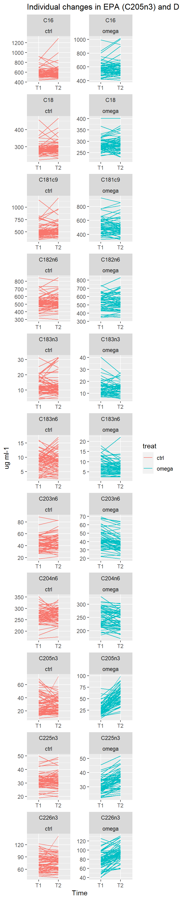
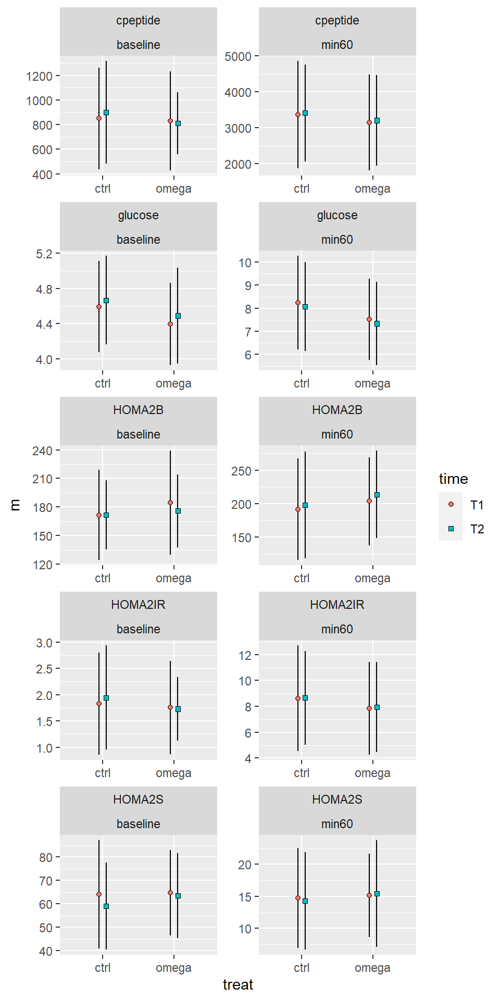
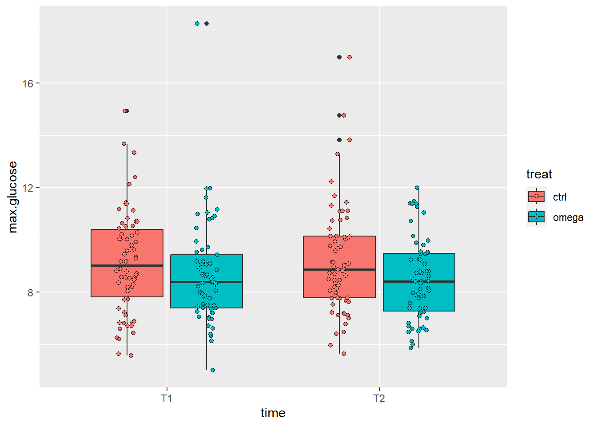
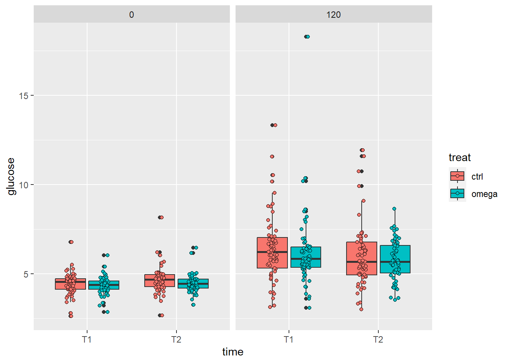

## Supplementation period


::: {.cell}

:::


### Omega-3 supplementation


::: {.cell}
::: {.cell-output-display}
{width=384}
:::
:::

::: {.cell}
::: {.cell-output-display}
```{=html}
<div id="bkjwcatfch" style="padding-left:0px;padding-right:0px;padding-top:10px;padding-bottom:10px;overflow-x:auto;overflow-y:auto;width:auto;height:auto;">
<style>#bkjwcatfch table {
  font-family: system-ui, 'Segoe UI', Roboto, Helvetica, Arial, sans-serif, 'Apple Color Emoji', 'Segoe UI Emoji', 'Segoe UI Symbol', 'Noto Color Emoji';
  -webkit-font-smoothing: antialiased;
  -moz-osx-font-smoothing: grayscale;
}

#bkjwcatfch thead, #bkjwcatfch tbody, #bkjwcatfch tfoot, #bkjwcatfch tr, #bkjwcatfch td, #bkjwcatfch th {
  border-style: none;
}

#bkjwcatfch p {
  margin: 0;
  padding: 0;
}

#bkjwcatfch .gt_table {
  display: table;
  border-collapse: collapse;
  line-height: normal;
  margin-left: auto;
  margin-right: auto;
  color: #333333;
  font-size: 16px;
  font-weight: normal;
  font-style: normal;
  background-color: #FFFFFF;
  width: auto;
  border-top-style: solid;
  border-top-width: 2px;
  border-top-color: #A8A8A8;
  border-right-style: none;
  border-right-width: 2px;
  border-right-color: #D3D3D3;
  border-bottom-style: solid;
  border-bottom-width: 2px;
  border-bottom-color: #A8A8A8;
  border-left-style: none;
  border-left-width: 2px;
  border-left-color: #D3D3D3;
}

#bkjwcatfch .gt_caption {
  padding-top: 4px;
  padding-bottom: 4px;
}

#bkjwcatfch .gt_title {
  color: #333333;
  font-size: 125%;
  font-weight: initial;
  padding-top: 4px;
  padding-bottom: 4px;
  padding-left: 5px;
  padding-right: 5px;
  border-bottom-color: #FFFFFF;
  border-bottom-width: 0;
}

#bkjwcatfch .gt_subtitle {
  color: #333333;
  font-size: 85%;
  font-weight: initial;
  padding-top: 3px;
  padding-bottom: 5px;
  padding-left: 5px;
  padding-right: 5px;
  border-top-color: #FFFFFF;
  border-top-width: 0;
}

#bkjwcatfch .gt_heading {
  background-color: #FFFFFF;
  text-align: center;
  border-bottom-color: #FFFFFF;
  border-left-style: none;
  border-left-width: 1px;
  border-left-color: #D3D3D3;
  border-right-style: none;
  border-right-width: 1px;
  border-right-color: #D3D3D3;
}

#bkjwcatfch .gt_bottom_border {
  border-bottom-style: solid;
  border-bottom-width: 2px;
  border-bottom-color: #D3D3D3;
}

#bkjwcatfch .gt_col_headings {
  border-top-style: solid;
  border-top-width: 2px;
  border-top-color: #D3D3D3;
  border-bottom-style: solid;
  border-bottom-width: 2px;
  border-bottom-color: #D3D3D3;
  border-left-style: none;
  border-left-width: 1px;
  border-left-color: #D3D3D3;
  border-right-style: none;
  border-right-width: 1px;
  border-right-color: #D3D3D3;
}

#bkjwcatfch .gt_col_heading {
  color: #333333;
  background-color: #FFFFFF;
  font-size: 100%;
  font-weight: normal;
  text-transform: inherit;
  border-left-style: none;
  border-left-width: 1px;
  border-left-color: #D3D3D3;
  border-right-style: none;
  border-right-width: 1px;
  border-right-color: #D3D3D3;
  vertical-align: bottom;
  padding-top: 5px;
  padding-bottom: 6px;
  padding-left: 5px;
  padding-right: 5px;
  overflow-x: hidden;
}

#bkjwcatfch .gt_column_spanner_outer {
  color: #333333;
  background-color: #FFFFFF;
  font-size: 100%;
  font-weight: normal;
  text-transform: inherit;
  padding-top: 0;
  padding-bottom: 0;
  padding-left: 4px;
  padding-right: 4px;
}

#bkjwcatfch .gt_column_spanner_outer:first-child {
  padding-left: 0;
}

#bkjwcatfch .gt_column_spanner_outer:last-child {
  padding-right: 0;
}

#bkjwcatfch .gt_column_spanner {
  border-bottom-style: solid;
  border-bottom-width: 2px;
  border-bottom-color: #D3D3D3;
  vertical-align: bottom;
  padding-top: 5px;
  padding-bottom: 5px;
  overflow-x: hidden;
  display: inline-block;
  width: 100%;
}

#bkjwcatfch .gt_spanner_row {
  border-bottom-style: hidden;
}

#bkjwcatfch .gt_group_heading {
  padding-top: 8px;
  padding-bottom: 8px;
  padding-left: 5px;
  padding-right: 5px;
  color: #333333;
  background-color: #FFFFFF;
  font-size: 100%;
  font-weight: initial;
  text-transform: inherit;
  border-top-style: solid;
  border-top-width: 2px;
  border-top-color: #D3D3D3;
  border-bottom-style: solid;
  border-bottom-width: 2px;
  border-bottom-color: #D3D3D3;
  border-left-style: none;
  border-left-width: 1px;
  border-left-color: #D3D3D3;
  border-right-style: none;
  border-right-width: 1px;
  border-right-color: #D3D3D3;
  vertical-align: middle;
  text-align: left;
}

#bkjwcatfch .gt_empty_group_heading {
  padding: 0.5px;
  color: #333333;
  background-color: #FFFFFF;
  font-size: 100%;
  font-weight: initial;
  border-top-style: solid;
  border-top-width: 2px;
  border-top-color: #D3D3D3;
  border-bottom-style: solid;
  border-bottom-width: 2px;
  border-bottom-color: #D3D3D3;
  vertical-align: middle;
}

#bkjwcatfch .gt_from_md > :first-child {
  margin-top: 0;
}

#bkjwcatfch .gt_from_md > :last-child {
  margin-bottom: 0;
}

#bkjwcatfch .gt_row {
  padding-top: 8px;
  padding-bottom: 8px;
  padding-left: 5px;
  padding-right: 5px;
  margin: 10px;
  border-top-style: solid;
  border-top-width: 1px;
  border-top-color: #D3D3D3;
  border-left-style: none;
  border-left-width: 1px;
  border-left-color: #D3D3D3;
  border-right-style: none;
  border-right-width: 1px;
  border-right-color: #D3D3D3;
  vertical-align: middle;
  overflow-x: hidden;
}

#bkjwcatfch .gt_stub {
  color: #333333;
  background-color: #FFFFFF;
  font-size: 100%;
  font-weight: initial;
  text-transform: inherit;
  border-right-style: solid;
  border-right-width: 2px;
  border-right-color: #D3D3D3;
  padding-left: 5px;
  padding-right: 5px;
}

#bkjwcatfch .gt_stub_row_group {
  color: #333333;
  background-color: #FFFFFF;
  font-size: 100%;
  font-weight: initial;
  text-transform: inherit;
  border-right-style: solid;
  border-right-width: 2px;
  border-right-color: #D3D3D3;
  padding-left: 5px;
  padding-right: 5px;
  vertical-align: top;
}

#bkjwcatfch .gt_row_group_first td {
  border-top-width: 2px;
}

#bkjwcatfch .gt_row_group_first th {
  border-top-width: 2px;
}

#bkjwcatfch .gt_summary_row {
  color: #333333;
  background-color: #FFFFFF;
  text-transform: inherit;
  padding-top: 8px;
  padding-bottom: 8px;
  padding-left: 5px;
  padding-right: 5px;
}

#bkjwcatfch .gt_first_summary_row {
  border-top-style: solid;
  border-top-color: #D3D3D3;
}

#bkjwcatfch .gt_first_summary_row.thick {
  border-top-width: 2px;
}

#bkjwcatfch .gt_last_summary_row {
  padding-top: 8px;
  padding-bottom: 8px;
  padding-left: 5px;
  padding-right: 5px;
  border-bottom-style: solid;
  border-bottom-width: 2px;
  border-bottom-color: #D3D3D3;
}

#bkjwcatfch .gt_grand_summary_row {
  color: #333333;
  background-color: #FFFFFF;
  text-transform: inherit;
  padding-top: 8px;
  padding-bottom: 8px;
  padding-left: 5px;
  padding-right: 5px;
}

#bkjwcatfch .gt_first_grand_summary_row {
  padding-top: 8px;
  padding-bottom: 8px;
  padding-left: 5px;
  padding-right: 5px;
  border-top-style: double;
  border-top-width: 6px;
  border-top-color: #D3D3D3;
}

#bkjwcatfch .gt_last_grand_summary_row_top {
  padding-top: 8px;
  padding-bottom: 8px;
  padding-left: 5px;
  padding-right: 5px;
  border-bottom-style: double;
  border-bottom-width: 6px;
  border-bottom-color: #D3D3D3;
}

#bkjwcatfch .gt_striped {
  background-color: rgba(128, 128, 128, 0.05);
}

#bkjwcatfch .gt_table_body {
  border-top-style: solid;
  border-top-width: 2px;
  border-top-color: #D3D3D3;
  border-bottom-style: solid;
  border-bottom-width: 2px;
  border-bottom-color: #D3D3D3;
}

#bkjwcatfch .gt_footnotes {
  color: #333333;
  background-color: #FFFFFF;
  border-bottom-style: none;
  border-bottom-width: 2px;
  border-bottom-color: #D3D3D3;
  border-left-style: none;
  border-left-width: 2px;
  border-left-color: #D3D3D3;
  border-right-style: none;
  border-right-width: 2px;
  border-right-color: #D3D3D3;
}

#bkjwcatfch .gt_footnote {
  margin: 0px;
  font-size: 90%;
  padding-top: 4px;
  padding-bottom: 4px;
  padding-left: 5px;
  padding-right: 5px;
}

#bkjwcatfch .gt_sourcenotes {
  color: #333333;
  background-color: #FFFFFF;
  border-bottom-style: none;
  border-bottom-width: 2px;
  border-bottom-color: #D3D3D3;
  border-left-style: none;
  border-left-width: 2px;
  border-left-color: #D3D3D3;
  border-right-style: none;
  border-right-width: 2px;
  border-right-color: #D3D3D3;
}

#bkjwcatfch .gt_sourcenote {
  font-size: 90%;
  padding-top: 4px;
  padding-bottom: 4px;
  padding-left: 5px;
  padding-right: 5px;
}

#bkjwcatfch .gt_left {
  text-align: left;
}

#bkjwcatfch .gt_center {
  text-align: center;
}

#bkjwcatfch .gt_right {
  text-align: right;
  font-variant-numeric: tabular-nums;
}

#bkjwcatfch .gt_font_normal {
  font-weight: normal;
}

#bkjwcatfch .gt_font_bold {
  font-weight: bold;
}

#bkjwcatfch .gt_font_italic {
  font-style: italic;
}

#bkjwcatfch .gt_super {
  font-size: 65%;
}

#bkjwcatfch .gt_footnote_marks {
  font-size: 75%;
  vertical-align: 0.4em;
  position: initial;
}

#bkjwcatfch .gt_asterisk {
  font-size: 100%;
  vertical-align: 0;
}

#bkjwcatfch .gt_indent_1 {
  text-indent: 5px;
}

#bkjwcatfch .gt_indent_2 {
  text-indent: 10px;
}

#bkjwcatfch .gt_indent_3 {
  text-indent: 15px;
}

#bkjwcatfch .gt_indent_4 {
  text-indent: 20px;
}

#bkjwcatfch .gt_indent_5 {
  text-indent: 25px;
}
</style>
<table class="gt_table" data-quarto-disable-processing="false" data-quarto-bootstrap="false">
  <thead>
    
    <tr class="gt_col_headings">
      <th class="gt_col_heading gt_columns_bottom_border gt_left" rowspan="1" colspan="1" scope="col" id="fa">fa</th>
      <th class="gt_col_heading gt_columns_bottom_border gt_right" rowspan="1" colspan="1" scope="col" id="T1_ctrl">T1_ctrl</th>
      <th class="gt_col_heading gt_columns_bottom_border gt_right" rowspan="1" colspan="1" scope="col" id="T1_omega">T1_omega</th>
      <th class="gt_col_heading gt_columns_bottom_border gt_right" rowspan="1" colspan="1" scope="col" id="T2_ctrl">T2_ctrl</th>
      <th class="gt_col_heading gt_columns_bottom_border gt_right" rowspan="1" colspan="1" scope="col" id="T2_omega">T2_omega</th>
      <th class="gt_col_heading gt_columns_bottom_border gt_right" rowspan="1" colspan="1" scope="col" id="estimate">estimate</th>
      <th class="gt_col_heading gt_columns_bottom_border gt_right" rowspan="1" colspan="1" scope="col" id="se">se</th>
      <th class="gt_col_heading gt_columns_bottom_border gt_right" rowspan="1" colspan="1" scope="col" id="t">t</th>
      <th class="gt_col_heading gt_columns_bottom_border gt_right" rowspan="1" colspan="1" scope="col" id="p">p</th>
      <th class="gt_col_heading gt_columns_bottom_border gt_right" rowspan="1" colspan="1" scope="col" id="lwr">lwr</th>
      <th class="gt_col_heading gt_columns_bottom_border gt_right" rowspan="1" colspan="1" scope="col" id="upr">upr</th>
    </tr>
  </thead>
  <tbody class="gt_table_body">
    <tr><td headers="fa" class="gt_row gt_left">C16</td>
<td headers="T1_ctrl" class="gt_row gt_right">591.1 (95.1)</td>
<td headers="T1_omega" class="gt_row gt_right">576.6 (104.4)</td>
<td headers="T2_ctrl" class="gt_row gt_right">605.1 (124.7)</td>
<td headers="T2_omega" class="gt_row gt_right">593.2 (124)</td>
<td headers="estimate" class="gt_row gt_right">0.929</td>
<td headers="se" class="gt_row gt_right">16.024</td>
<td headers="t" class="gt_row gt_right">0.058</td>
<td headers="p" class="gt_row gt_right">0.954</td>
<td headers="lwr" class="gt_row gt_right">−30.801</td>
<td headers="upr" class="gt_row gt_right">32.658</td></tr>
    <tr><td headers="fa" class="gt_row gt_left">C18</td>
<td headers="T1_ctrl" class="gt_row gt_right">289.2 (35.7)</td>
<td headers="T1_omega" class="gt_row gt_right">284.6 (30.5)</td>
<td headers="T2_ctrl" class="gt_row gt_right">295.3 (37.8)</td>
<td headers="T2_omega" class="gt_row gt_right">288.9 (34.3)</td>
<td headers="estimate" class="gt_row gt_right">−2.860</td>
<td headers="se" class="gt_row gt_right">4.747</td>
<td headers="t" class="gt_row gt_right">−0.602</td>
<td headers="p" class="gt_row gt_right">0.548</td>
<td headers="lwr" class="gt_row gt_right">−12.259</td>
<td headers="upr" class="gt_row gt_right">6.540</td></tr>
    <tr><td headers="fa" class="gt_row gt_left">C181c9</td>
<td headers="T1_ctrl" class="gt_row gt_right">532.7 (137.4)</td>
<td headers="T1_omega" class="gt_row gt_right">519 (115.3)</td>
<td headers="T2_ctrl" class="gt_row gt_right">549.8 (150)</td>
<td headers="T2_omega" class="gt_row gt_right">506.3 (119.7)</td>
<td headers="estimate" class="gt_row gt_right">−33.268</td>
<td headers="se" class="gt_row gt_right">16.212</td>
<td headers="t" class="gt_row gt_right">−2.052</td>
<td headers="p" class="gt_row gt_right">0.042</td>
<td headers="lwr" class="gt_row gt_right">−65.369</td>
<td headers="upr" class="gt_row gt_right">−1.167</td></tr>
    <tr><td headers="fa" class="gt_row gt_left">C182n6</td>
<td headers="T1_ctrl" class="gt_row gt_right">520.5 (94.5)</td>
<td headers="T1_omega" class="gt_row gt_right">529.9 (95.3)</td>
<td headers="T2_ctrl" class="gt_row gt_right">534.7 (95.3)</td>
<td headers="T2_omega" class="gt_row gt_right">532.4 (98.8)</td>
<td headers="estimate" class="gt_row gt_right">−7.629</td>
<td headers="se" class="gt_row gt_right">10.474</td>
<td headers="t" class="gt_row gt_right">−0.728</td>
<td headers="p" class="gt_row gt_right">0.468</td>
<td headers="lwr" class="gt_row gt_right">−28.367</td>
<td headers="upr" class="gt_row gt_right">13.110</td></tr>
    <tr><td headers="fa" class="gt_row gt_left">C183n3</td>
<td headers="T1_ctrl" class="gt_row gt_right">13 (5.1)</td>
<td headers="T1_omega" class="gt_row gt_right">14.1 (6.3)</td>
<td headers="T2_ctrl" class="gt_row gt_right">13.1 (6.6)</td>
<td headers="T2_omega" class="gt_row gt_right">13.5 (5.2)</td>
<td headers="estimate" class="gt_row gt_right">−0.247</td>
<td headers="se" class="gt_row gt_right">0.798</td>
<td headers="t" class="gt_row gt_right">−0.309</td>
<td headers="p" class="gt_row gt_right">0.758</td>
<td headers="lwr" class="gt_row gt_right">−1.826</td>
<td headers="upr" class="gt_row gt_right">1.333</td></tr>
    <tr><td headers="fa" class="gt_row gt_left">C183n6</td>
<td headers="T1_ctrl" class="gt_row gt_right">8.6 (3.1)</td>
<td headers="T1_omega" class="gt_row gt_right">7.9 (3.6)</td>
<td headers="T2_ctrl" class="gt_row gt_right">8.7 (3.6)</td>
<td headers="T2_omega" class="gt_row gt_right">7.1 (3.3)</td>
<td headers="estimate" class="gt_row gt_right">−1.366</td>
<td headers="se" class="gt_row gt_right">0.490</td>
<td headers="t" class="gt_row gt_right">−2.790</td>
<td headers="p" class="gt_row gt_right">0.006</td>
<td headers="lwr" class="gt_row gt_right">−2.336</td>
<td headers="upr" class="gt_row gt_right">−0.396</td></tr>
    <tr><td headers="fa" class="gt_row gt_left">C203n6</td>
<td headers="T1_ctrl" class="gt_row gt_right">44.5 (11.9)</td>
<td headers="T1_omega" class="gt_row gt_right">42.6 (11.3)</td>
<td headers="T2_ctrl" class="gt_row gt_right">45.4 (13.1)</td>
<td headers="T2_omega" class="gt_row gt_right">38.8 (9.9)</td>
<td headers="estimate" class="gt_row gt_right">−5.794</td>
<td headers="se" class="gt_row gt_right">1.191</td>
<td headers="t" class="gt_row gt_right">−4.864</td>
<td headers="p" class="gt_row gt_right">0.000</td>
<td headers="lwr" class="gt_row gt_right">−8.153</td>
<td headers="upr" class="gt_row gt_right">−3.436</td></tr>
    <tr><td headers="fa" class="gt_row gt_left">C204n6</td>
<td headers="T1_ctrl" class="gt_row gt_right">267.3 (32.8)</td>
<td headers="T1_omega" class="gt_row gt_right">249.6 (33.6)</td>
<td headers="T2_ctrl" class="gt_row gt_right">271.4 (29.7)</td>
<td headers="T2_omega" class="gt_row gt_right">241.6 (33.9)</td>
<td headers="estimate" class="gt_row gt_right">−16.988</td>
<td headers="se" class="gt_row gt_right">4.136</td>
<td headers="t" class="gt_row gt_right">−4.108</td>
<td headers="p" class="gt_row gt_right">0.000</td>
<td headers="lwr" class="gt_row gt_right">−25.177</td>
<td headers="upr" class="gt_row gt_right">−8.799</td></tr>
    <tr><td headers="fa" class="gt_row gt_left">C205n3</td>
<td headers="T1_ctrl" class="gt_row gt_right">29.6 (14.9)</td>
<td headers="T1_omega" class="gt_row gt_right">27.1 (12.9)</td>
<td headers="T2_ctrl" class="gt_row gt_right">29.2 (12.2)</td>
<td headers="T2_omega" class="gt_row gt_right">57.7 (17.8)</td>
<td headers="estimate" class="gt_row gt_right">29.664</td>
<td headers="se" class="gt_row gt_right">2.431</td>
<td headers="t" class="gt_row gt_right">12.202</td>
<td headers="p" class="gt_row gt_right">0.000</td>
<td headers="lwr" class="gt_row gt_right">24.850</td>
<td headers="upr" class="gt_row gt_right">34.478</td></tr>
    <tr><td headers="fa" class="gt_row gt_left">C225n3</td>
<td headers="T1_ctrl" class="gt_row gt_right">31.8 (5.4)</td>
<td headers="T1_omega" class="gt_row gt_right">30.6 (4.9)</td>
<td headers="T2_ctrl" class="gt_row gt_right">32 (5.9)</td>
<td headers="T2_omega" class="gt_row gt_right">35.6 (5.9)</td>
<td headers="estimate" class="gt_row gt_right">4.547</td>
<td headers="se" class="gt_row gt_right">0.622</td>
<td headers="t" class="gt_row gt_right">7.304</td>
<td headers="p" class="gt_row gt_right">0.000</td>
<td headers="lwr" class="gt_row gt_right">3.314</td>
<td headers="upr" class="gt_row gt_right">5.780</td></tr>
    <tr><td headers="fa" class="gt_row gt_left">C226n3</td>
<td headers="T1_ctrl" class="gt_row gt_right">76.8 (19.7)</td>
<td headers="T1_omega" class="gt_row gt_right">77.2 (18.8)</td>
<td headers="T2_ctrl" class="gt_row gt_right">77.1 (18.9)</td>
<td headers="T2_omega" class="gt_row gt_right">94.8 (16.7)</td>
<td headers="estimate" class="gt_row gt_right">17.959</td>
<td headers="se" class="gt_row gt_right">2.248</td>
<td headers="t" class="gt_row gt_right">7.989</td>
<td headers="p" class="gt_row gt_right">0.000</td>
<td headers="lwr" class="gt_row gt_right">13.508</td>
<td headers="upr" class="gt_row gt_right">22.410</td></tr>
  </tbody>
  
  
</table>
</div>
```
:::
:::


### Glucose metabolism


::: {#tbl-glucose .cell tbl-cap='ANCOVA results Omega-3 vs. CTRL (T2 ~ T1 + treat)'}
::: {.cell-output-display}
```{=html}
<div id="isiwjqjvju" style="padding-left:0px;padding-right:0px;padding-top:10px;padding-bottom:10px;overflow-x:auto;overflow-y:auto;width:auto;height:auto;">
<style>#isiwjqjvju table {
  font-family: system-ui, 'Segoe UI', Roboto, Helvetica, Arial, sans-serif, 'Apple Color Emoji', 'Segoe UI Emoji', 'Segoe UI Symbol', 'Noto Color Emoji';
  -webkit-font-smoothing: antialiased;
  -moz-osx-font-smoothing: grayscale;
}

#isiwjqjvju thead, #isiwjqjvju tbody, #isiwjqjvju tfoot, #isiwjqjvju tr, #isiwjqjvju td, #isiwjqjvju th {
  border-style: none;
}

#isiwjqjvju p {
  margin: 0;
  padding: 0;
}

#isiwjqjvju .gt_table {
  display: table;
  border-collapse: collapse;
  line-height: normal;
  margin-left: auto;
  margin-right: auto;
  color: #333333;
  font-size: 16px;
  font-weight: normal;
  font-style: normal;
  background-color: #FFFFFF;
  width: auto;
  border-top-style: solid;
  border-top-width: 2px;
  border-top-color: #A8A8A8;
  border-right-style: none;
  border-right-width: 2px;
  border-right-color: #D3D3D3;
  border-bottom-style: solid;
  border-bottom-width: 2px;
  border-bottom-color: #A8A8A8;
  border-left-style: none;
  border-left-width: 2px;
  border-left-color: #D3D3D3;
}

#isiwjqjvju .gt_caption {
  padding-top: 4px;
  padding-bottom: 4px;
}

#isiwjqjvju .gt_title {
  color: #333333;
  font-size: 125%;
  font-weight: initial;
  padding-top: 4px;
  padding-bottom: 4px;
  padding-left: 5px;
  padding-right: 5px;
  border-bottom-color: #FFFFFF;
  border-bottom-width: 0;
}

#isiwjqjvju .gt_subtitle {
  color: #333333;
  font-size: 85%;
  font-weight: initial;
  padding-top: 3px;
  padding-bottom: 5px;
  padding-left: 5px;
  padding-right: 5px;
  border-top-color: #FFFFFF;
  border-top-width: 0;
}

#isiwjqjvju .gt_heading {
  background-color: #FFFFFF;
  text-align: center;
  border-bottom-color: #FFFFFF;
  border-left-style: none;
  border-left-width: 1px;
  border-left-color: #D3D3D3;
  border-right-style: none;
  border-right-width: 1px;
  border-right-color: #D3D3D3;
}

#isiwjqjvju .gt_bottom_border {
  border-bottom-style: solid;
  border-bottom-width: 2px;
  border-bottom-color: #D3D3D3;
}

#isiwjqjvju .gt_col_headings {
  border-top-style: solid;
  border-top-width: 2px;
  border-top-color: #D3D3D3;
  border-bottom-style: solid;
  border-bottom-width: 2px;
  border-bottom-color: #D3D3D3;
  border-left-style: none;
  border-left-width: 1px;
  border-left-color: #D3D3D3;
  border-right-style: none;
  border-right-width: 1px;
  border-right-color: #D3D3D3;
}

#isiwjqjvju .gt_col_heading {
  color: #333333;
  background-color: #FFFFFF;
  font-size: 100%;
  font-weight: normal;
  text-transform: inherit;
  border-left-style: none;
  border-left-width: 1px;
  border-left-color: #D3D3D3;
  border-right-style: none;
  border-right-width: 1px;
  border-right-color: #D3D3D3;
  vertical-align: bottom;
  padding-top: 5px;
  padding-bottom: 6px;
  padding-left: 5px;
  padding-right: 5px;
  overflow-x: hidden;
}

#isiwjqjvju .gt_column_spanner_outer {
  color: #333333;
  background-color: #FFFFFF;
  font-size: 100%;
  font-weight: normal;
  text-transform: inherit;
  padding-top: 0;
  padding-bottom: 0;
  padding-left: 4px;
  padding-right: 4px;
}

#isiwjqjvju .gt_column_spanner_outer:first-child {
  padding-left: 0;
}

#isiwjqjvju .gt_column_spanner_outer:last-child {
  padding-right: 0;
}

#isiwjqjvju .gt_column_spanner {
  border-bottom-style: solid;
  border-bottom-width: 2px;
  border-bottom-color: #D3D3D3;
  vertical-align: bottom;
  padding-top: 5px;
  padding-bottom: 5px;
  overflow-x: hidden;
  display: inline-block;
  width: 100%;
}

#isiwjqjvju .gt_spanner_row {
  border-bottom-style: hidden;
}

#isiwjqjvju .gt_group_heading {
  padding-top: 8px;
  padding-bottom: 8px;
  padding-left: 5px;
  padding-right: 5px;
  color: #333333;
  background-color: #FFFFFF;
  font-size: 100%;
  font-weight: initial;
  text-transform: inherit;
  border-top-style: solid;
  border-top-width: 2px;
  border-top-color: #D3D3D3;
  border-bottom-style: solid;
  border-bottom-width: 2px;
  border-bottom-color: #D3D3D3;
  border-left-style: none;
  border-left-width: 1px;
  border-left-color: #D3D3D3;
  border-right-style: none;
  border-right-width: 1px;
  border-right-color: #D3D3D3;
  vertical-align: middle;
  text-align: left;
}

#isiwjqjvju .gt_empty_group_heading {
  padding: 0.5px;
  color: #333333;
  background-color: #FFFFFF;
  font-size: 100%;
  font-weight: initial;
  border-top-style: solid;
  border-top-width: 2px;
  border-top-color: #D3D3D3;
  border-bottom-style: solid;
  border-bottom-width: 2px;
  border-bottom-color: #D3D3D3;
  vertical-align: middle;
}

#isiwjqjvju .gt_from_md > :first-child {
  margin-top: 0;
}

#isiwjqjvju .gt_from_md > :last-child {
  margin-bottom: 0;
}

#isiwjqjvju .gt_row {
  padding-top: 8px;
  padding-bottom: 8px;
  padding-left: 5px;
  padding-right: 5px;
  margin: 10px;
  border-top-style: solid;
  border-top-width: 1px;
  border-top-color: #D3D3D3;
  border-left-style: none;
  border-left-width: 1px;
  border-left-color: #D3D3D3;
  border-right-style: none;
  border-right-width: 1px;
  border-right-color: #D3D3D3;
  vertical-align: middle;
  overflow-x: hidden;
}

#isiwjqjvju .gt_stub {
  color: #333333;
  background-color: #FFFFFF;
  font-size: 100%;
  font-weight: initial;
  text-transform: inherit;
  border-right-style: solid;
  border-right-width: 2px;
  border-right-color: #D3D3D3;
  padding-left: 5px;
  padding-right: 5px;
}

#isiwjqjvju .gt_stub_row_group {
  color: #333333;
  background-color: #FFFFFF;
  font-size: 100%;
  font-weight: initial;
  text-transform: inherit;
  border-right-style: solid;
  border-right-width: 2px;
  border-right-color: #D3D3D3;
  padding-left: 5px;
  padding-right: 5px;
  vertical-align: top;
}

#isiwjqjvju .gt_row_group_first td {
  border-top-width: 2px;
}

#isiwjqjvju .gt_row_group_first th {
  border-top-width: 2px;
}

#isiwjqjvju .gt_summary_row {
  color: #333333;
  background-color: #FFFFFF;
  text-transform: inherit;
  padding-top: 8px;
  padding-bottom: 8px;
  padding-left: 5px;
  padding-right: 5px;
}

#isiwjqjvju .gt_first_summary_row {
  border-top-style: solid;
  border-top-color: #D3D3D3;
}

#isiwjqjvju .gt_first_summary_row.thick {
  border-top-width: 2px;
}

#isiwjqjvju .gt_last_summary_row {
  padding-top: 8px;
  padding-bottom: 8px;
  padding-left: 5px;
  padding-right: 5px;
  border-bottom-style: solid;
  border-bottom-width: 2px;
  border-bottom-color: #D3D3D3;
}

#isiwjqjvju .gt_grand_summary_row {
  color: #333333;
  background-color: #FFFFFF;
  text-transform: inherit;
  padding-top: 8px;
  padding-bottom: 8px;
  padding-left: 5px;
  padding-right: 5px;
}

#isiwjqjvju .gt_first_grand_summary_row {
  padding-top: 8px;
  padding-bottom: 8px;
  padding-left: 5px;
  padding-right: 5px;
  border-top-style: double;
  border-top-width: 6px;
  border-top-color: #D3D3D3;
}

#isiwjqjvju .gt_last_grand_summary_row_top {
  padding-top: 8px;
  padding-bottom: 8px;
  padding-left: 5px;
  padding-right: 5px;
  border-bottom-style: double;
  border-bottom-width: 6px;
  border-bottom-color: #D3D3D3;
}

#isiwjqjvju .gt_striped {
  background-color: rgba(128, 128, 128, 0.05);
}

#isiwjqjvju .gt_table_body {
  border-top-style: solid;
  border-top-width: 2px;
  border-top-color: #D3D3D3;
  border-bottom-style: solid;
  border-bottom-width: 2px;
  border-bottom-color: #D3D3D3;
}

#isiwjqjvju .gt_footnotes {
  color: #333333;
  background-color: #FFFFFF;
  border-bottom-style: none;
  border-bottom-width: 2px;
  border-bottom-color: #D3D3D3;
  border-left-style: none;
  border-left-width: 2px;
  border-left-color: #D3D3D3;
  border-right-style: none;
  border-right-width: 2px;
  border-right-color: #D3D3D3;
}

#isiwjqjvju .gt_footnote {
  margin: 0px;
  font-size: 90%;
  padding-top: 4px;
  padding-bottom: 4px;
  padding-left: 5px;
  padding-right: 5px;
}

#isiwjqjvju .gt_sourcenotes {
  color: #333333;
  background-color: #FFFFFF;
  border-bottom-style: none;
  border-bottom-width: 2px;
  border-bottom-color: #D3D3D3;
  border-left-style: none;
  border-left-width: 2px;
  border-left-color: #D3D3D3;
  border-right-style: none;
  border-right-width: 2px;
  border-right-color: #D3D3D3;
}

#isiwjqjvju .gt_sourcenote {
  font-size: 90%;
  padding-top: 4px;
  padding-bottom: 4px;
  padding-left: 5px;
  padding-right: 5px;
}

#isiwjqjvju .gt_left {
  text-align: left;
}

#isiwjqjvju .gt_center {
  text-align: center;
}

#isiwjqjvju .gt_right {
  text-align: right;
  font-variant-numeric: tabular-nums;
}

#isiwjqjvju .gt_font_normal {
  font-weight: normal;
}

#isiwjqjvju .gt_font_bold {
  font-weight: bold;
}

#isiwjqjvju .gt_font_italic {
  font-style: italic;
}

#isiwjqjvju .gt_super {
  font-size: 65%;
}

#isiwjqjvju .gt_footnote_marks {
  font-size: 75%;
  vertical-align: 0.4em;
  position: initial;
}

#isiwjqjvju .gt_asterisk {
  font-size: 100%;
  vertical-align: 0;
}

#isiwjqjvju .gt_indent_1 {
  text-indent: 5px;
}

#isiwjqjvju .gt_indent_2 {
  text-indent: 10px;
}

#isiwjqjvju .gt_indent_3 {
  text-indent: 15px;
}

#isiwjqjvju .gt_indent_4 {
  text-indent: 20px;
}

#isiwjqjvju .gt_indent_5 {
  text-indent: 25px;
}
</style>
<table class="gt_table" data-quarto-disable-processing="false" data-quarto-bootstrap="false">
  <thead>
    
    <tr class="gt_col_headings">
      <th class="gt_col_heading gt_columns_bottom_border gt_left" rowspan="1" colspan="1" scope="col" id="analyste">analyste</th>
      <th class="gt_col_heading gt_columns_bottom_border gt_left" rowspan="1" colspan="1" scope="col" id="min">min</th>
      <th class="gt_col_heading gt_columns_bottom_border gt_right" rowspan="1" colspan="1" scope="col" id="estimate">estimate</th>
      <th class="gt_col_heading gt_columns_bottom_border gt_right" rowspan="1" colspan="1" scope="col" id="se">se</th>
      <th class="gt_col_heading gt_columns_bottom_border gt_right" rowspan="1" colspan="1" scope="col" id="t">t</th>
      <th class="gt_col_heading gt_columns_bottom_border gt_right" rowspan="1" colspan="1" scope="col" id="p">p</th>
      <th class="gt_col_heading gt_columns_bottom_border gt_right" rowspan="1" colspan="1" scope="col" id="lwr">lwr</th>
      <th class="gt_col_heading gt_columns_bottom_border gt_right" rowspan="1" colspan="1" scope="col" id="upr">upr</th>
    </tr>
  </thead>
  <tbody class="gt_table_body">
    <tr><td headers="analyste" class="gt_row gt_left">glucose</td>
<td headers="min" class="gt_row gt_left">baseline</td>
<td headers="estimate" class="gt_row gt_right">−0.050</td>
<td headers="se" class="gt_row gt_right">0.091</td>
<td headers="t" class="gt_row gt_right">−0.551</td>
<td headers="p" class="gt_row gt_right">0.583</td>
<td headers="lwr" class="gt_row gt_right">−0.231</td>
<td headers="upr" class="gt_row gt_right">0.131</td></tr>
    <tr><td headers="analyste" class="gt_row gt_left">glucose</td>
<td headers="min" class="gt_row gt_left">min60</td>
<td headers="estimate" class="gt_row gt_right">−0.197</td>
<td headers="se" class="gt_row gt_right">0.282</td>
<td headers="t" class="gt_row gt_right">−0.699</td>
<td headers="p" class="gt_row gt_right">0.487</td>
<td headers="lwr" class="gt_row gt_right">−0.758</td>
<td headers="upr" class="gt_row gt_right">0.364</td></tr>
    <tr><td headers="analyste" class="gt_row gt_left">cpeptide</td>
<td headers="min" class="gt_row gt_left">baseline</td>
<td headers="estimate" class="gt_row gt_right">−67.751</td>
<td headers="se" class="gt_row gt_right">49.641</td>
<td headers="t" class="gt_row gt_right">−1.365</td>
<td headers="p" class="gt_row gt_right">0.176</td>
<td headers="lwr" class="gt_row gt_right">−166.386</td>
<td headers="upr" class="gt_row gt_right">30.884</td></tr>
    <tr><td headers="analyste" class="gt_row gt_left">cpeptide</td>
<td headers="min" class="gt_row gt_left">min60</td>
<td headers="estimate" class="gt_row gt_right">2.969</td>
<td headers="se" class="gt_row gt_right">148.502</td>
<td headers="t" class="gt_row gt_right">0.020</td>
<td headers="p" class="gt_row gt_right">0.984</td>
<td headers="lwr" class="gt_row gt_right">−292.242</td>
<td headers="upr" class="gt_row gt_right">298.180</td></tr>
    <tr><td headers="analyste" class="gt_row gt_left">HOMA2B</td>
<td headers="min" class="gt_row gt_left">baseline</td>
<td headers="estimate" class="gt_row gt_right">0.223</td>
<td headers="se" class="gt_row gt_right">6.849</td>
<td headers="t" class="gt_row gt_right">0.033</td>
<td headers="p" class="gt_row gt_right">0.974</td>
<td headers="lwr" class="gt_row gt_right">−13.387</td>
<td headers="upr" class="gt_row gt_right">13.832</td></tr>
    <tr><td headers="analyste" class="gt_row gt_left">HOMA2B</td>
<td headers="min" class="gt_row gt_left">min60</td>
<td headers="estimate" class="gt_row gt_right">6.864</td>
<td headers="se" class="gt_row gt_right">10.715</td>
<td headers="t" class="gt_row gt_right">0.641</td>
<td headers="p" class="gt_row gt_right">0.523</td>
<td headers="lwr" class="gt_row gt_right">−14.440</td>
<td headers="upr" class="gt_row gt_right">28.168</td></tr>
    <tr><td headers="analyste" class="gt_row gt_left">HOMA2S</td>
<td headers="min" class="gt_row gt_left">baseline</td>
<td headers="estimate" class="gt_row gt_right">2.825</td>
<td headers="se" class="gt_row gt_right">2.743</td>
<td headers="t" class="gt_row gt_right">1.030</td>
<td headers="p" class="gt_row gt_right">0.306</td>
<td headers="lwr" class="gt_row gt_right">−2.626</td>
<td headers="upr" class="gt_row gt_right">8.276</td></tr>
    <tr><td headers="analyste" class="gt_row gt_left">HOMA2S</td>
<td headers="min" class="gt_row gt_left">min60</td>
<td headers="estimate" class="gt_row gt_right">0.529</td>
<td headers="se" class="gt_row gt_right">0.829</td>
<td headers="t" class="gt_row gt_right">0.638</td>
<td headers="p" class="gt_row gt_right">0.525</td>
<td headers="lwr" class="gt_row gt_right">−1.119</td>
<td headers="upr" class="gt_row gt_right">2.177</td></tr>
    <tr><td headers="analyste" class="gt_row gt_left">HOMA2IR</td>
<td headers="min" class="gt_row gt_left">baseline</td>
<td headers="estimate" class="gt_row gt_right">−0.152</td>
<td headers="se" class="gt_row gt_right">0.112</td>
<td headers="t" class="gt_row gt_right">−1.350</td>
<td headers="p" class="gt_row gt_right">0.180</td>
<td headers="lwr" class="gt_row gt_right">−0.375</td>
<td headers="upr" class="gt_row gt_right">0.072</td></tr>
    <tr><td headers="analyste" class="gt_row gt_left">HOMA2IR</td>
<td headers="min" class="gt_row gt_left">min60</td>
<td headers="estimate" class="gt_row gt_right">−0.058</td>
<td headers="se" class="gt_row gt_right">0.434</td>
<td headers="t" class="gt_row gt_right">−0.134</td>
<td headers="p" class="gt_row gt_right">0.894</td>
<td headers="lwr" class="gt_row gt_right">−0.920</td>
<td headers="upr" class="gt_row gt_right">0.804</td></tr>
  </tbody>
  
  
</table>
</div>
```
:::
:::

::: {.cell layout-align="center"}
::: {.cell-output-display}
{fig-align='center' width=480}
:::
:::

::: {#tbl-maximal-glucose .cell tbl-cap='Maximal glucose during glucose tolerance test'}
::: {.cell-output-display}
```{=html}
<div id="kdtvcexhkl" style="padding-left:0px;padding-right:0px;padding-top:10px;padding-bottom:10px;overflow-x:auto;overflow-y:auto;width:auto;height:auto;">
<style>#kdtvcexhkl table {
  font-family: system-ui, 'Segoe UI', Roboto, Helvetica, Arial, sans-serif, 'Apple Color Emoji', 'Segoe UI Emoji', 'Segoe UI Symbol', 'Noto Color Emoji';
  -webkit-font-smoothing: antialiased;
  -moz-osx-font-smoothing: grayscale;
}

#kdtvcexhkl thead, #kdtvcexhkl tbody, #kdtvcexhkl tfoot, #kdtvcexhkl tr, #kdtvcexhkl td, #kdtvcexhkl th {
  border-style: none;
}

#kdtvcexhkl p {
  margin: 0;
  padding: 0;
}

#kdtvcexhkl .gt_table {
  display: table;
  border-collapse: collapse;
  line-height: normal;
  margin-left: auto;
  margin-right: auto;
  color: #333333;
  font-size: 16px;
  font-weight: normal;
  font-style: normal;
  background-color: #FFFFFF;
  width: auto;
  border-top-style: solid;
  border-top-width: 2px;
  border-top-color: #A8A8A8;
  border-right-style: none;
  border-right-width: 2px;
  border-right-color: #D3D3D3;
  border-bottom-style: solid;
  border-bottom-width: 2px;
  border-bottom-color: #A8A8A8;
  border-left-style: none;
  border-left-width: 2px;
  border-left-color: #D3D3D3;
}

#kdtvcexhkl .gt_caption {
  padding-top: 4px;
  padding-bottom: 4px;
}

#kdtvcexhkl .gt_title {
  color: #333333;
  font-size: 125%;
  font-weight: initial;
  padding-top: 4px;
  padding-bottom: 4px;
  padding-left: 5px;
  padding-right: 5px;
  border-bottom-color: #FFFFFF;
  border-bottom-width: 0;
}

#kdtvcexhkl .gt_subtitle {
  color: #333333;
  font-size: 85%;
  font-weight: initial;
  padding-top: 3px;
  padding-bottom: 5px;
  padding-left: 5px;
  padding-right: 5px;
  border-top-color: #FFFFFF;
  border-top-width: 0;
}

#kdtvcexhkl .gt_heading {
  background-color: #FFFFFF;
  text-align: center;
  border-bottom-color: #FFFFFF;
  border-left-style: none;
  border-left-width: 1px;
  border-left-color: #D3D3D3;
  border-right-style: none;
  border-right-width: 1px;
  border-right-color: #D3D3D3;
}

#kdtvcexhkl .gt_bottom_border {
  border-bottom-style: solid;
  border-bottom-width: 2px;
  border-bottom-color: #D3D3D3;
}

#kdtvcexhkl .gt_col_headings {
  border-top-style: solid;
  border-top-width: 2px;
  border-top-color: #D3D3D3;
  border-bottom-style: solid;
  border-bottom-width: 2px;
  border-bottom-color: #D3D3D3;
  border-left-style: none;
  border-left-width: 1px;
  border-left-color: #D3D3D3;
  border-right-style: none;
  border-right-width: 1px;
  border-right-color: #D3D3D3;
}

#kdtvcexhkl .gt_col_heading {
  color: #333333;
  background-color: #FFFFFF;
  font-size: 100%;
  font-weight: normal;
  text-transform: inherit;
  border-left-style: none;
  border-left-width: 1px;
  border-left-color: #D3D3D3;
  border-right-style: none;
  border-right-width: 1px;
  border-right-color: #D3D3D3;
  vertical-align: bottom;
  padding-top: 5px;
  padding-bottom: 6px;
  padding-left: 5px;
  padding-right: 5px;
  overflow-x: hidden;
}

#kdtvcexhkl .gt_column_spanner_outer {
  color: #333333;
  background-color: #FFFFFF;
  font-size: 100%;
  font-weight: normal;
  text-transform: inherit;
  padding-top: 0;
  padding-bottom: 0;
  padding-left: 4px;
  padding-right: 4px;
}

#kdtvcexhkl .gt_column_spanner_outer:first-child {
  padding-left: 0;
}

#kdtvcexhkl .gt_column_spanner_outer:last-child {
  padding-right: 0;
}

#kdtvcexhkl .gt_column_spanner {
  border-bottom-style: solid;
  border-bottom-width: 2px;
  border-bottom-color: #D3D3D3;
  vertical-align: bottom;
  padding-top: 5px;
  padding-bottom: 5px;
  overflow-x: hidden;
  display: inline-block;
  width: 100%;
}

#kdtvcexhkl .gt_spanner_row {
  border-bottom-style: hidden;
}

#kdtvcexhkl .gt_group_heading {
  padding-top: 8px;
  padding-bottom: 8px;
  padding-left: 5px;
  padding-right: 5px;
  color: #333333;
  background-color: #FFFFFF;
  font-size: 100%;
  font-weight: initial;
  text-transform: inherit;
  border-top-style: solid;
  border-top-width: 2px;
  border-top-color: #D3D3D3;
  border-bottom-style: solid;
  border-bottom-width: 2px;
  border-bottom-color: #D3D3D3;
  border-left-style: none;
  border-left-width: 1px;
  border-left-color: #D3D3D3;
  border-right-style: none;
  border-right-width: 1px;
  border-right-color: #D3D3D3;
  vertical-align: middle;
  text-align: left;
}

#kdtvcexhkl .gt_empty_group_heading {
  padding: 0.5px;
  color: #333333;
  background-color: #FFFFFF;
  font-size: 100%;
  font-weight: initial;
  border-top-style: solid;
  border-top-width: 2px;
  border-top-color: #D3D3D3;
  border-bottom-style: solid;
  border-bottom-width: 2px;
  border-bottom-color: #D3D3D3;
  vertical-align: middle;
}

#kdtvcexhkl .gt_from_md > :first-child {
  margin-top: 0;
}

#kdtvcexhkl .gt_from_md > :last-child {
  margin-bottom: 0;
}

#kdtvcexhkl .gt_row {
  padding-top: 8px;
  padding-bottom: 8px;
  padding-left: 5px;
  padding-right: 5px;
  margin: 10px;
  border-top-style: solid;
  border-top-width: 1px;
  border-top-color: #D3D3D3;
  border-left-style: none;
  border-left-width: 1px;
  border-left-color: #D3D3D3;
  border-right-style: none;
  border-right-width: 1px;
  border-right-color: #D3D3D3;
  vertical-align: middle;
  overflow-x: hidden;
}

#kdtvcexhkl .gt_stub {
  color: #333333;
  background-color: #FFFFFF;
  font-size: 100%;
  font-weight: initial;
  text-transform: inherit;
  border-right-style: solid;
  border-right-width: 2px;
  border-right-color: #D3D3D3;
  padding-left: 5px;
  padding-right: 5px;
}

#kdtvcexhkl .gt_stub_row_group {
  color: #333333;
  background-color: #FFFFFF;
  font-size: 100%;
  font-weight: initial;
  text-transform: inherit;
  border-right-style: solid;
  border-right-width: 2px;
  border-right-color: #D3D3D3;
  padding-left: 5px;
  padding-right: 5px;
  vertical-align: top;
}

#kdtvcexhkl .gt_row_group_first td {
  border-top-width: 2px;
}

#kdtvcexhkl .gt_row_group_first th {
  border-top-width: 2px;
}

#kdtvcexhkl .gt_summary_row {
  color: #333333;
  background-color: #FFFFFF;
  text-transform: inherit;
  padding-top: 8px;
  padding-bottom: 8px;
  padding-left: 5px;
  padding-right: 5px;
}

#kdtvcexhkl .gt_first_summary_row {
  border-top-style: solid;
  border-top-color: #D3D3D3;
}

#kdtvcexhkl .gt_first_summary_row.thick {
  border-top-width: 2px;
}

#kdtvcexhkl .gt_last_summary_row {
  padding-top: 8px;
  padding-bottom: 8px;
  padding-left: 5px;
  padding-right: 5px;
  border-bottom-style: solid;
  border-bottom-width: 2px;
  border-bottom-color: #D3D3D3;
}

#kdtvcexhkl .gt_grand_summary_row {
  color: #333333;
  background-color: #FFFFFF;
  text-transform: inherit;
  padding-top: 8px;
  padding-bottom: 8px;
  padding-left: 5px;
  padding-right: 5px;
}

#kdtvcexhkl .gt_first_grand_summary_row {
  padding-top: 8px;
  padding-bottom: 8px;
  padding-left: 5px;
  padding-right: 5px;
  border-top-style: double;
  border-top-width: 6px;
  border-top-color: #D3D3D3;
}

#kdtvcexhkl .gt_last_grand_summary_row_top {
  padding-top: 8px;
  padding-bottom: 8px;
  padding-left: 5px;
  padding-right: 5px;
  border-bottom-style: double;
  border-bottom-width: 6px;
  border-bottom-color: #D3D3D3;
}

#kdtvcexhkl .gt_striped {
  background-color: rgba(128, 128, 128, 0.05);
}

#kdtvcexhkl .gt_table_body {
  border-top-style: solid;
  border-top-width: 2px;
  border-top-color: #D3D3D3;
  border-bottom-style: solid;
  border-bottom-width: 2px;
  border-bottom-color: #D3D3D3;
}

#kdtvcexhkl .gt_footnotes {
  color: #333333;
  background-color: #FFFFFF;
  border-bottom-style: none;
  border-bottom-width: 2px;
  border-bottom-color: #D3D3D3;
  border-left-style: none;
  border-left-width: 2px;
  border-left-color: #D3D3D3;
  border-right-style: none;
  border-right-width: 2px;
  border-right-color: #D3D3D3;
}

#kdtvcexhkl .gt_footnote {
  margin: 0px;
  font-size: 90%;
  padding-top: 4px;
  padding-bottom: 4px;
  padding-left: 5px;
  padding-right: 5px;
}

#kdtvcexhkl .gt_sourcenotes {
  color: #333333;
  background-color: #FFFFFF;
  border-bottom-style: none;
  border-bottom-width: 2px;
  border-bottom-color: #D3D3D3;
  border-left-style: none;
  border-left-width: 2px;
  border-left-color: #D3D3D3;
  border-right-style: none;
  border-right-width: 2px;
  border-right-color: #D3D3D3;
}

#kdtvcexhkl .gt_sourcenote {
  font-size: 90%;
  padding-top: 4px;
  padding-bottom: 4px;
  padding-left: 5px;
  padding-right: 5px;
}

#kdtvcexhkl .gt_left {
  text-align: left;
}

#kdtvcexhkl .gt_center {
  text-align: center;
}

#kdtvcexhkl .gt_right {
  text-align: right;
  font-variant-numeric: tabular-nums;
}

#kdtvcexhkl .gt_font_normal {
  font-weight: normal;
}

#kdtvcexhkl .gt_font_bold {
  font-weight: bold;
}

#kdtvcexhkl .gt_font_italic {
  font-style: italic;
}

#kdtvcexhkl .gt_super {
  font-size: 65%;
}

#kdtvcexhkl .gt_footnote_marks {
  font-size: 75%;
  vertical-align: 0.4em;
  position: initial;
}

#kdtvcexhkl .gt_asterisk {
  font-size: 100%;
  vertical-align: 0;
}

#kdtvcexhkl .gt_indent_1 {
  text-indent: 5px;
}

#kdtvcexhkl .gt_indent_2 {
  text-indent: 10px;
}

#kdtvcexhkl .gt_indent_3 {
  text-indent: 15px;
}

#kdtvcexhkl .gt_indent_4 {
  text-indent: 20px;
}

#kdtvcexhkl .gt_indent_5 {
  text-indent: 25px;
}
</style>
<table class="gt_table" data-quarto-disable-processing="false" data-quarto-bootstrap="false">
  <thead>
    
    <tr class="gt_col_headings">
      <th class="gt_col_heading gt_columns_bottom_border gt_left" rowspan="1" colspan="1" scope="col" id="treat">treat</th>
      <th class="gt_col_heading gt_columns_bottom_border gt_right" rowspan="1" colspan="1" scope="col" id="Mean">Mean</th>
      <th class="gt_col_heading gt_columns_bottom_border gt_right" rowspan="1" colspan="1" scope="col" id="SD">SD</th>
      <th class="gt_col_heading gt_columns_bottom_border gt_right" rowspan="1" colspan="1" scope="col" id="Min">Min</th>
      <th class="gt_col_heading gt_columns_bottom_border gt_right" rowspan="1" colspan="1" scope="col" id="Max">Max</th>
      <th class="gt_col_heading gt_columns_bottom_border gt_right" rowspan="1" colspan="1" scope="col" id="n_above10">n_above10</th>
      <th class="gt_col_heading gt_columns_bottom_border gt_right" rowspan="1" colspan="1" scope="col" id="n_above11">n_above11</th>
      <th class="gt_col_heading gt_columns_bottom_border gt_right" rowspan="1" colspan="1" scope="col" id="n">n</th>
    </tr>
  </thead>
  <tbody class="gt_table_body">
    <tr class="gt_group_heading_row">
      <th colspan="8" class="gt_group_heading" scope="colgroup" id="T1">T1</th>
    </tr>
    <tr class="gt_row_group_first"><td headers="T1  treat" class="gt_row gt_left">ctrl</td>
<td headers="T1  Mean" class="gt_row gt_right">9.14</td>
<td headers="T1  SD" class="gt_row gt_right">1.96</td>
<td headers="T1  Min" class="gt_row gt_right">5.56</td>
<td headers="T1  Max" class="gt_row gt_right">14.92</td>
<td headers="T1  n_above10" class="gt_row gt_right">23</td>
<td headers="T1  n_above11" class="gt_row gt_right">10</td>
<td headers="T1  n" class="gt_row gt_right">66</td></tr>
    <tr><td headers="T1  treat" class="gt_row gt_left">omega</td>
<td headers="T1  Mean" class="gt_row gt_right">8.68</td>
<td headers="T1  SD" class="gt_row gt_right">1.98</td>
<td headers="T1  Min" class="gt_row gt_right">5.00</td>
<td headers="T1  Max" class="gt_row gt_right">18.27</td>
<td headers="T1  n_above10" class="gt_row gt_right">11</td>
<td headers="T1  n_above11" class="gt_row gt_right">6</td>
<td headers="T1  n" class="gt_row gt_right">61</td></tr>
    <tr class="gt_group_heading_row">
      <th colspan="8" class="gt_group_heading" scope="colgroup" id="T2">T2</th>
    </tr>
    <tr class="gt_row_group_first"><td headers="T2  treat" class="gt_row gt_left">ctrl</td>
<td headers="T2  Mean" class="gt_row gt_right">9.20</td>
<td headers="T2  SD" class="gt_row gt_right">2.08</td>
<td headers="T2  Min" class="gt_row gt_right">5.64</td>
<td headers="T2  Max" class="gt_row gt_right">16.98</td>
<td headers="T2  n_above10" class="gt_row gt_right">20</td>
<td headers="T2  n_above11" class="gt_row gt_right">11</td>
<td headers="T2  n" class="gt_row gt_right">65</td></tr>
    <tr><td headers="T2  treat" class="gt_row gt_left">omega</td>
<td headers="T2  Mean" class="gt_row gt_right">8.48</td>
<td headers="T2  SD" class="gt_row gt_right">1.57</td>
<td headers="T2  Min" class="gt_row gt_right">5.85</td>
<td headers="T2  Max" class="gt_row gt_right">11.98</td>
<td headers="T2  n_above10" class="gt_row gt_right">9</td>
<td headers="T2  n_above11" class="gt_row gt_right">7</td>
<td headers="T2  n" class="gt_row gt_right">60</td></tr>
  </tbody>
  
  
</table>
</div>
```
:::
:::

::: {.cell}
::: {.cell-output-display}
{width=672}
:::
:::

::: {#tbl-resting-glucose .cell tbl-cap='Resting and 2-h glucose from glucose tolerance test'}
::: {.cell-output-display}
```{=html}
<div id="ungenwqoye" style="padding-left:0px;padding-right:0px;padding-top:10px;padding-bottom:10px;overflow-x:auto;overflow-y:auto;width:auto;height:auto;">
<style>#ungenwqoye table {
  font-family: system-ui, 'Segoe UI', Roboto, Helvetica, Arial, sans-serif, 'Apple Color Emoji', 'Segoe UI Emoji', 'Segoe UI Symbol', 'Noto Color Emoji';
  -webkit-font-smoothing: antialiased;
  -moz-osx-font-smoothing: grayscale;
}

#ungenwqoye thead, #ungenwqoye tbody, #ungenwqoye tfoot, #ungenwqoye tr, #ungenwqoye td, #ungenwqoye th {
  border-style: none;
}

#ungenwqoye p {
  margin: 0;
  padding: 0;
}

#ungenwqoye .gt_table {
  display: table;
  border-collapse: collapse;
  line-height: normal;
  margin-left: auto;
  margin-right: auto;
  color: #333333;
  font-size: 16px;
  font-weight: normal;
  font-style: normal;
  background-color: #FFFFFF;
  width: auto;
  border-top-style: solid;
  border-top-width: 2px;
  border-top-color: #A8A8A8;
  border-right-style: none;
  border-right-width: 2px;
  border-right-color: #D3D3D3;
  border-bottom-style: solid;
  border-bottom-width: 2px;
  border-bottom-color: #A8A8A8;
  border-left-style: none;
  border-left-width: 2px;
  border-left-color: #D3D3D3;
}

#ungenwqoye .gt_caption {
  padding-top: 4px;
  padding-bottom: 4px;
}

#ungenwqoye .gt_title {
  color: #333333;
  font-size: 125%;
  font-weight: initial;
  padding-top: 4px;
  padding-bottom: 4px;
  padding-left: 5px;
  padding-right: 5px;
  border-bottom-color: #FFFFFF;
  border-bottom-width: 0;
}

#ungenwqoye .gt_subtitle {
  color: #333333;
  font-size: 85%;
  font-weight: initial;
  padding-top: 3px;
  padding-bottom: 5px;
  padding-left: 5px;
  padding-right: 5px;
  border-top-color: #FFFFFF;
  border-top-width: 0;
}

#ungenwqoye .gt_heading {
  background-color: #FFFFFF;
  text-align: center;
  border-bottom-color: #FFFFFF;
  border-left-style: none;
  border-left-width: 1px;
  border-left-color: #D3D3D3;
  border-right-style: none;
  border-right-width: 1px;
  border-right-color: #D3D3D3;
}

#ungenwqoye .gt_bottom_border {
  border-bottom-style: solid;
  border-bottom-width: 2px;
  border-bottom-color: #D3D3D3;
}

#ungenwqoye .gt_col_headings {
  border-top-style: solid;
  border-top-width: 2px;
  border-top-color: #D3D3D3;
  border-bottom-style: solid;
  border-bottom-width: 2px;
  border-bottom-color: #D3D3D3;
  border-left-style: none;
  border-left-width: 1px;
  border-left-color: #D3D3D3;
  border-right-style: none;
  border-right-width: 1px;
  border-right-color: #D3D3D3;
}

#ungenwqoye .gt_col_heading {
  color: #333333;
  background-color: #FFFFFF;
  font-size: 100%;
  font-weight: normal;
  text-transform: inherit;
  border-left-style: none;
  border-left-width: 1px;
  border-left-color: #D3D3D3;
  border-right-style: none;
  border-right-width: 1px;
  border-right-color: #D3D3D3;
  vertical-align: bottom;
  padding-top: 5px;
  padding-bottom: 6px;
  padding-left: 5px;
  padding-right: 5px;
  overflow-x: hidden;
}

#ungenwqoye .gt_column_spanner_outer {
  color: #333333;
  background-color: #FFFFFF;
  font-size: 100%;
  font-weight: normal;
  text-transform: inherit;
  padding-top: 0;
  padding-bottom: 0;
  padding-left: 4px;
  padding-right: 4px;
}

#ungenwqoye .gt_column_spanner_outer:first-child {
  padding-left: 0;
}

#ungenwqoye .gt_column_spanner_outer:last-child {
  padding-right: 0;
}

#ungenwqoye .gt_column_spanner {
  border-bottom-style: solid;
  border-bottom-width: 2px;
  border-bottom-color: #D3D3D3;
  vertical-align: bottom;
  padding-top: 5px;
  padding-bottom: 5px;
  overflow-x: hidden;
  display: inline-block;
  width: 100%;
}

#ungenwqoye .gt_spanner_row {
  border-bottom-style: hidden;
}

#ungenwqoye .gt_group_heading {
  padding-top: 8px;
  padding-bottom: 8px;
  padding-left: 5px;
  padding-right: 5px;
  color: #333333;
  background-color: #FFFFFF;
  font-size: 100%;
  font-weight: initial;
  text-transform: inherit;
  border-top-style: solid;
  border-top-width: 2px;
  border-top-color: #D3D3D3;
  border-bottom-style: solid;
  border-bottom-width: 2px;
  border-bottom-color: #D3D3D3;
  border-left-style: none;
  border-left-width: 1px;
  border-left-color: #D3D3D3;
  border-right-style: none;
  border-right-width: 1px;
  border-right-color: #D3D3D3;
  vertical-align: middle;
  text-align: left;
}

#ungenwqoye .gt_empty_group_heading {
  padding: 0.5px;
  color: #333333;
  background-color: #FFFFFF;
  font-size: 100%;
  font-weight: initial;
  border-top-style: solid;
  border-top-width: 2px;
  border-top-color: #D3D3D3;
  border-bottom-style: solid;
  border-bottom-width: 2px;
  border-bottom-color: #D3D3D3;
  vertical-align: middle;
}

#ungenwqoye .gt_from_md > :first-child {
  margin-top: 0;
}

#ungenwqoye .gt_from_md > :last-child {
  margin-bottom: 0;
}

#ungenwqoye .gt_row {
  padding-top: 8px;
  padding-bottom: 8px;
  padding-left: 5px;
  padding-right: 5px;
  margin: 10px;
  border-top-style: solid;
  border-top-width: 1px;
  border-top-color: #D3D3D3;
  border-left-style: none;
  border-left-width: 1px;
  border-left-color: #D3D3D3;
  border-right-style: none;
  border-right-width: 1px;
  border-right-color: #D3D3D3;
  vertical-align: middle;
  overflow-x: hidden;
}

#ungenwqoye .gt_stub {
  color: #333333;
  background-color: #FFFFFF;
  font-size: 100%;
  font-weight: initial;
  text-transform: inherit;
  border-right-style: solid;
  border-right-width: 2px;
  border-right-color: #D3D3D3;
  padding-left: 5px;
  padding-right: 5px;
}

#ungenwqoye .gt_stub_row_group {
  color: #333333;
  background-color: #FFFFFF;
  font-size: 100%;
  font-weight: initial;
  text-transform: inherit;
  border-right-style: solid;
  border-right-width: 2px;
  border-right-color: #D3D3D3;
  padding-left: 5px;
  padding-right: 5px;
  vertical-align: top;
}

#ungenwqoye .gt_row_group_first td {
  border-top-width: 2px;
}

#ungenwqoye .gt_row_group_first th {
  border-top-width: 2px;
}

#ungenwqoye .gt_summary_row {
  color: #333333;
  background-color: #FFFFFF;
  text-transform: inherit;
  padding-top: 8px;
  padding-bottom: 8px;
  padding-left: 5px;
  padding-right: 5px;
}

#ungenwqoye .gt_first_summary_row {
  border-top-style: solid;
  border-top-color: #D3D3D3;
}

#ungenwqoye .gt_first_summary_row.thick {
  border-top-width: 2px;
}

#ungenwqoye .gt_last_summary_row {
  padding-top: 8px;
  padding-bottom: 8px;
  padding-left: 5px;
  padding-right: 5px;
  border-bottom-style: solid;
  border-bottom-width: 2px;
  border-bottom-color: #D3D3D3;
}

#ungenwqoye .gt_grand_summary_row {
  color: #333333;
  background-color: #FFFFFF;
  text-transform: inherit;
  padding-top: 8px;
  padding-bottom: 8px;
  padding-left: 5px;
  padding-right: 5px;
}

#ungenwqoye .gt_first_grand_summary_row {
  padding-top: 8px;
  padding-bottom: 8px;
  padding-left: 5px;
  padding-right: 5px;
  border-top-style: double;
  border-top-width: 6px;
  border-top-color: #D3D3D3;
}

#ungenwqoye .gt_last_grand_summary_row_top {
  padding-top: 8px;
  padding-bottom: 8px;
  padding-left: 5px;
  padding-right: 5px;
  border-bottom-style: double;
  border-bottom-width: 6px;
  border-bottom-color: #D3D3D3;
}

#ungenwqoye .gt_striped {
  background-color: rgba(128, 128, 128, 0.05);
}

#ungenwqoye .gt_table_body {
  border-top-style: solid;
  border-top-width: 2px;
  border-top-color: #D3D3D3;
  border-bottom-style: solid;
  border-bottom-width: 2px;
  border-bottom-color: #D3D3D3;
}

#ungenwqoye .gt_footnotes {
  color: #333333;
  background-color: #FFFFFF;
  border-bottom-style: none;
  border-bottom-width: 2px;
  border-bottom-color: #D3D3D3;
  border-left-style: none;
  border-left-width: 2px;
  border-left-color: #D3D3D3;
  border-right-style: none;
  border-right-width: 2px;
  border-right-color: #D3D3D3;
}

#ungenwqoye .gt_footnote {
  margin: 0px;
  font-size: 90%;
  padding-top: 4px;
  padding-bottom: 4px;
  padding-left: 5px;
  padding-right: 5px;
}

#ungenwqoye .gt_sourcenotes {
  color: #333333;
  background-color: #FFFFFF;
  border-bottom-style: none;
  border-bottom-width: 2px;
  border-bottom-color: #D3D3D3;
  border-left-style: none;
  border-left-width: 2px;
  border-left-color: #D3D3D3;
  border-right-style: none;
  border-right-width: 2px;
  border-right-color: #D3D3D3;
}

#ungenwqoye .gt_sourcenote {
  font-size: 90%;
  padding-top: 4px;
  padding-bottom: 4px;
  padding-left: 5px;
  padding-right: 5px;
}

#ungenwqoye .gt_left {
  text-align: left;
}

#ungenwqoye .gt_center {
  text-align: center;
}

#ungenwqoye .gt_right {
  text-align: right;
  font-variant-numeric: tabular-nums;
}

#ungenwqoye .gt_font_normal {
  font-weight: normal;
}

#ungenwqoye .gt_font_bold {
  font-weight: bold;
}

#ungenwqoye .gt_font_italic {
  font-style: italic;
}

#ungenwqoye .gt_super {
  font-size: 65%;
}

#ungenwqoye .gt_footnote_marks {
  font-size: 75%;
  vertical-align: 0.4em;
  position: initial;
}

#ungenwqoye .gt_asterisk {
  font-size: 100%;
  vertical-align: 0;
}

#ungenwqoye .gt_indent_1 {
  text-indent: 5px;
}

#ungenwqoye .gt_indent_2 {
  text-indent: 10px;
}

#ungenwqoye .gt_indent_3 {
  text-indent: 15px;
}

#ungenwqoye .gt_indent_4 {
  text-indent: 20px;
}

#ungenwqoye .gt_indent_5 {
  text-indent: 25px;
}
</style>
<table class="gt_table" data-quarto-disable-processing="false" data-quarto-bootstrap="false">
  <thead>
    
    <tr class="gt_col_headings">
      <th class="gt_col_heading gt_columns_bottom_border gt_right" rowspan="1" colspan="1" scope="col" id="min">min</th>
      <th class="gt_col_heading gt_columns_bottom_border gt_right" rowspan="1" colspan="1" scope="col" id="Mean">Mean</th>
      <th class="gt_col_heading gt_columns_bottom_border gt_right" rowspan="1" colspan="1" scope="col" id="SD">SD</th>
      <th class="gt_col_heading gt_columns_bottom_border gt_right" rowspan="1" colspan="1" scope="col" id="Min">Min</th>
      <th class="gt_col_heading gt_columns_bottom_border gt_right" rowspan="1" colspan="1" scope="col" id="Max">Max</th>
      <th class="gt_col_heading gt_columns_bottom_border gt_right" rowspan="1" colspan="1" scope="col" id="n_above7">n_above7</th>
      <th class="gt_col_heading gt_columns_bottom_border gt_right" rowspan="1" colspan="1" scope="col" id="n_above11">n_above11</th>
      <th class="gt_col_heading gt_columns_bottom_border gt_right" rowspan="1" colspan="1" scope="col" id="n">n</th>
    </tr>
  </thead>
  <tbody class="gt_table_body">
    <tr class="gt_group_heading_row">
      <th colspan="8" class="gt_group_heading" scope="colgroup" id="T1 - ctrl">T1 - ctrl</th>
    </tr>
    <tr class="gt_row_group_first"><td headers="T1 - ctrl  min" class="gt_row gt_right">0</td>
<td headers="T1 - ctrl  Mean" class="gt_row gt_right">4.43</td>
<td headers="T1 - ctrl  SD" class="gt_row gt_right">0.60</td>
<td headers="T1 - ctrl  Min" class="gt_row gt_right">2.62</td>
<td headers="T1 - ctrl  Max" class="gt_row gt_right">6.79</td>
<td headers="T1 - ctrl  n_above7" class="gt_row gt_right">0</td>
<td headers="T1 - ctrl  n_above11" class="gt_row gt_right">0</td>
<td headers="T1 - ctrl  n" class="gt_row gt_right">66</td></tr>
    <tr><td headers="T1 - ctrl  min" class="gt_row gt_right">120</td>
<td headers="T1 - ctrl  Mean" class="gt_row gt_right">6.42</td>
<td headers="T1 - ctrl  SD" class="gt_row gt_right">1.88</td>
<td headers="T1 - ctrl  Min" class="gt_row gt_right">3.14</td>
<td headers="T1 - ctrl  Max" class="gt_row gt_right">13.33</td>
<td headers="T1 - ctrl  n_above7" class="gt_row gt_right">17</td>
<td headers="T1 - ctrl  n_above11" class="gt_row gt_right">2</td>
<td headers="T1 - ctrl  n" class="gt_row gt_right">65</td></tr>
    <tr class="gt_group_heading_row">
      <th colspan="8" class="gt_group_heading" scope="colgroup" id="T1 - omega">T1 - omega</th>
    </tr>
    <tr class="gt_row_group_first"><td headers="T1 - omega  min" class="gt_row gt_right">0</td>
<td headers="T1 - omega  Mean" class="gt_row gt_right">4.36</td>
<td headers="T1 - omega  SD" class="gt_row gt_right">0.49</td>
<td headers="T1 - omega  Min" class="gt_row gt_right">2.86</td>
<td headers="T1 - omega  Max" class="gt_row gt_right">6.03</td>
<td headers="T1 - omega  n_above7" class="gt_row gt_right">0</td>
<td headers="T1 - omega  n_above11" class="gt_row gt_right">0</td>
<td headers="T1 - omega  n" class="gt_row gt_right">61</td></tr>
    <tr><td headers="T1 - omega  min" class="gt_row gt_right">120</td>
<td headers="T1 - omega  Mean" class="gt_row gt_right">6.21</td>
<td headers="T1 - omega  SD" class="gt_row gt_right">2.10</td>
<td headers="T1 - omega  Min" class="gt_row gt_right">3.10</td>
<td headers="T1 - omega  Max" class="gt_row gt_right">18.27</td>
<td headers="T1 - omega  n_above7" class="gt_row gt_right">9</td>
<td headers="T1 - omega  n_above11" class="gt_row gt_right">1</td>
<td headers="T1 - omega  n" class="gt_row gt_right">60</td></tr>
    <tr class="gt_group_heading_row">
      <th colspan="8" class="gt_group_heading" scope="colgroup" id="T2 - ctrl">T2 - ctrl</th>
    </tr>
    <tr class="gt_row_group_first"><td headers="T2 - ctrl  min" class="gt_row gt_right">0</td>
<td headers="T2 - ctrl  Mean" class="gt_row gt_right">4.66</td>
<td headers="T2 - ctrl  SD" class="gt_row gt_right">0.71</td>
<td headers="T2 - ctrl  Min" class="gt_row gt_right">2.68</td>
<td headers="T2 - ctrl  Max" class="gt_row gt_right">8.15</td>
<td headers="T2 - ctrl  n_above7" class="gt_row gt_right">1</td>
<td headers="T2 - ctrl  n_above11" class="gt_row gt_right">0</td>
<td headers="T2 - ctrl  n" class="gt_row gt_right">65</td></tr>
    <tr><td headers="T2 - ctrl  min" class="gt_row gt_right">120</td>
<td headers="T2 - ctrl  Mean" class="gt_row gt_right">5.99</td>
<td headers="T2 - ctrl  SD" class="gt_row gt_right">1.79</td>
<td headers="T2 - ctrl  Min" class="gt_row gt_right">3.01</td>
<td headers="T2 - ctrl  Max" class="gt_row gt_right">11.93</td>
<td headers="T2 - ctrl  n_above7" class="gt_row gt_right">13</td>
<td headers="T2 - ctrl  n_above11" class="gt_row gt_right">2</td>
<td headers="T2 - ctrl  n" class="gt_row gt_right">64</td></tr>
    <tr class="gt_group_heading_row">
      <th colspan="8" class="gt_group_heading" scope="colgroup" id="T2 - omega">T2 - omega</th>
    </tr>
    <tr class="gt_row_group_first"><td headers="T2 - omega  min" class="gt_row gt_right">0</td>
<td headers="T2 - omega  Mean" class="gt_row gt_right">4.48</td>
<td headers="T2 - omega  SD" class="gt_row gt_right">0.50</td>
<td headers="T2 - omega  Min" class="gt_row gt_right">3.27</td>
<td headers="T2 - omega  Max" class="gt_row gt_right">6.47</td>
<td headers="T2 - omega  n_above7" class="gt_row gt_right">0</td>
<td headers="T2 - omega  n_above11" class="gt_row gt_right">0</td>
<td headers="T2 - omega  n" class="gt_row gt_right">60</td></tr>
    <tr><td headers="T2 - omega  min" class="gt_row gt_right">120</td>
<td headers="T2 - omega  Mean" class="gt_row gt_right">5.71</td>
<td headers="T2 - omega  SD" class="gt_row gt_right">1.12</td>
<td headers="T2 - omega  Min" class="gt_row gt_right">3.55</td>
<td headers="T2 - omega  Max" class="gt_row gt_right">8.65</td>
<td headers="T2 - omega  n_above7" class="gt_row gt_right">7</td>
<td headers="T2 - omega  n_above11" class="gt_row gt_right">0</td>
<td headers="T2 - omega  n" class="gt_row gt_right">60</td></tr>
  </tbody>
  
  
</table>
</div>
```
:::
:::

::: {.cell}
::: {.cell-output-display}
{width=672}
:::
:::


### ECSS abstract: Relative fat mass is not associated with muscle adaptations to resistance training


::: {.cell tbl-cap='Descriptive statistics Vastus lateralis thickness (VL) at time 2 and 4 (T) and relative fat mass at T2'}
::: {.cell-output-display}
```{=html}
<div id="rqvkapzuei" style="padding-left:0px;padding-right:0px;padding-top:10px;padding-bottom:10px;overflow-x:auto;overflow-y:auto;width:auto;height:auto;">
<style>#rqvkapzuei table {
  font-family: system-ui, 'Segoe UI', Roboto, Helvetica, Arial, sans-serif, 'Apple Color Emoji', 'Segoe UI Emoji', 'Segoe UI Symbol', 'Noto Color Emoji';
  -webkit-font-smoothing: antialiased;
  -moz-osx-font-smoothing: grayscale;
}

#rqvkapzuei thead, #rqvkapzuei tbody, #rqvkapzuei tfoot, #rqvkapzuei tr, #rqvkapzuei td, #rqvkapzuei th {
  border-style: none;
}

#rqvkapzuei p {
  margin: 0;
  padding: 0;
}

#rqvkapzuei .gt_table {
  display: table;
  border-collapse: collapse;
  line-height: normal;
  margin-left: auto;
  margin-right: auto;
  color: #333333;
  font-size: 16px;
  font-weight: normal;
  font-style: normal;
  background-color: #FFFFFF;
  width: auto;
  border-top-style: solid;
  border-top-width: 2px;
  border-top-color: #A8A8A8;
  border-right-style: none;
  border-right-width: 2px;
  border-right-color: #D3D3D3;
  border-bottom-style: solid;
  border-bottom-width: 2px;
  border-bottom-color: #A8A8A8;
  border-left-style: none;
  border-left-width: 2px;
  border-left-color: #D3D3D3;
}

#rqvkapzuei .gt_caption {
  padding-top: 4px;
  padding-bottom: 4px;
}

#rqvkapzuei .gt_title {
  color: #333333;
  font-size: 125%;
  font-weight: initial;
  padding-top: 4px;
  padding-bottom: 4px;
  padding-left: 5px;
  padding-right: 5px;
  border-bottom-color: #FFFFFF;
  border-bottom-width: 0;
}

#rqvkapzuei .gt_subtitle {
  color: #333333;
  font-size: 85%;
  font-weight: initial;
  padding-top: 3px;
  padding-bottom: 5px;
  padding-left: 5px;
  padding-right: 5px;
  border-top-color: #FFFFFF;
  border-top-width: 0;
}

#rqvkapzuei .gt_heading {
  background-color: #FFFFFF;
  text-align: center;
  border-bottom-color: #FFFFFF;
  border-left-style: none;
  border-left-width: 1px;
  border-left-color: #D3D3D3;
  border-right-style: none;
  border-right-width: 1px;
  border-right-color: #D3D3D3;
}

#rqvkapzuei .gt_bottom_border {
  border-bottom-style: solid;
  border-bottom-width: 2px;
  border-bottom-color: #D3D3D3;
}

#rqvkapzuei .gt_col_headings {
  border-top-style: solid;
  border-top-width: 2px;
  border-top-color: #D3D3D3;
  border-bottom-style: solid;
  border-bottom-width: 2px;
  border-bottom-color: #D3D3D3;
  border-left-style: none;
  border-left-width: 1px;
  border-left-color: #D3D3D3;
  border-right-style: none;
  border-right-width: 1px;
  border-right-color: #D3D3D3;
}

#rqvkapzuei .gt_col_heading {
  color: #333333;
  background-color: #FFFFFF;
  font-size: 100%;
  font-weight: normal;
  text-transform: inherit;
  border-left-style: none;
  border-left-width: 1px;
  border-left-color: #D3D3D3;
  border-right-style: none;
  border-right-width: 1px;
  border-right-color: #D3D3D3;
  vertical-align: bottom;
  padding-top: 5px;
  padding-bottom: 6px;
  padding-left: 5px;
  padding-right: 5px;
  overflow-x: hidden;
}

#rqvkapzuei .gt_column_spanner_outer {
  color: #333333;
  background-color: #FFFFFF;
  font-size: 100%;
  font-weight: normal;
  text-transform: inherit;
  padding-top: 0;
  padding-bottom: 0;
  padding-left: 4px;
  padding-right: 4px;
}

#rqvkapzuei .gt_column_spanner_outer:first-child {
  padding-left: 0;
}

#rqvkapzuei .gt_column_spanner_outer:last-child {
  padding-right: 0;
}

#rqvkapzuei .gt_column_spanner {
  border-bottom-style: solid;
  border-bottom-width: 2px;
  border-bottom-color: #D3D3D3;
  vertical-align: bottom;
  padding-top: 5px;
  padding-bottom: 5px;
  overflow-x: hidden;
  display: inline-block;
  width: 100%;
}

#rqvkapzuei .gt_spanner_row {
  border-bottom-style: hidden;
}

#rqvkapzuei .gt_group_heading {
  padding-top: 8px;
  padding-bottom: 8px;
  padding-left: 5px;
  padding-right: 5px;
  color: #333333;
  background-color: #FFFFFF;
  font-size: 100%;
  font-weight: initial;
  text-transform: inherit;
  border-top-style: solid;
  border-top-width: 2px;
  border-top-color: #D3D3D3;
  border-bottom-style: solid;
  border-bottom-width: 2px;
  border-bottom-color: #D3D3D3;
  border-left-style: none;
  border-left-width: 1px;
  border-left-color: #D3D3D3;
  border-right-style: none;
  border-right-width: 1px;
  border-right-color: #D3D3D3;
  vertical-align: middle;
  text-align: left;
}

#rqvkapzuei .gt_empty_group_heading {
  padding: 0.5px;
  color: #333333;
  background-color: #FFFFFF;
  font-size: 100%;
  font-weight: initial;
  border-top-style: solid;
  border-top-width: 2px;
  border-top-color: #D3D3D3;
  border-bottom-style: solid;
  border-bottom-width: 2px;
  border-bottom-color: #D3D3D3;
  vertical-align: middle;
}

#rqvkapzuei .gt_from_md > :first-child {
  margin-top: 0;
}

#rqvkapzuei .gt_from_md > :last-child {
  margin-bottom: 0;
}

#rqvkapzuei .gt_row {
  padding-top: 8px;
  padding-bottom: 8px;
  padding-left: 5px;
  padding-right: 5px;
  margin: 10px;
  border-top-style: solid;
  border-top-width: 1px;
  border-top-color: #D3D3D3;
  border-left-style: none;
  border-left-width: 1px;
  border-left-color: #D3D3D3;
  border-right-style: none;
  border-right-width: 1px;
  border-right-color: #D3D3D3;
  vertical-align: middle;
  overflow-x: hidden;
}

#rqvkapzuei .gt_stub {
  color: #333333;
  background-color: #FFFFFF;
  font-size: 100%;
  font-weight: initial;
  text-transform: inherit;
  border-right-style: solid;
  border-right-width: 2px;
  border-right-color: #D3D3D3;
  padding-left: 5px;
  padding-right: 5px;
}

#rqvkapzuei .gt_stub_row_group {
  color: #333333;
  background-color: #FFFFFF;
  font-size: 100%;
  font-weight: initial;
  text-transform: inherit;
  border-right-style: solid;
  border-right-width: 2px;
  border-right-color: #D3D3D3;
  padding-left: 5px;
  padding-right: 5px;
  vertical-align: top;
}

#rqvkapzuei .gt_row_group_first td {
  border-top-width: 2px;
}

#rqvkapzuei .gt_row_group_first th {
  border-top-width: 2px;
}

#rqvkapzuei .gt_summary_row {
  color: #333333;
  background-color: #FFFFFF;
  text-transform: inherit;
  padding-top: 8px;
  padding-bottom: 8px;
  padding-left: 5px;
  padding-right: 5px;
}

#rqvkapzuei .gt_first_summary_row {
  border-top-style: solid;
  border-top-color: #D3D3D3;
}

#rqvkapzuei .gt_first_summary_row.thick {
  border-top-width: 2px;
}

#rqvkapzuei .gt_last_summary_row {
  padding-top: 8px;
  padding-bottom: 8px;
  padding-left: 5px;
  padding-right: 5px;
  border-bottom-style: solid;
  border-bottom-width: 2px;
  border-bottom-color: #D3D3D3;
}

#rqvkapzuei .gt_grand_summary_row {
  color: #333333;
  background-color: #FFFFFF;
  text-transform: inherit;
  padding-top: 8px;
  padding-bottom: 8px;
  padding-left: 5px;
  padding-right: 5px;
}

#rqvkapzuei .gt_first_grand_summary_row {
  padding-top: 8px;
  padding-bottom: 8px;
  padding-left: 5px;
  padding-right: 5px;
  border-top-style: double;
  border-top-width: 6px;
  border-top-color: #D3D3D3;
}

#rqvkapzuei .gt_last_grand_summary_row_top {
  padding-top: 8px;
  padding-bottom: 8px;
  padding-left: 5px;
  padding-right: 5px;
  border-bottom-style: double;
  border-bottom-width: 6px;
  border-bottom-color: #D3D3D3;
}

#rqvkapzuei .gt_striped {
  background-color: rgba(128, 128, 128, 0.05);
}

#rqvkapzuei .gt_table_body {
  border-top-style: solid;
  border-top-width: 2px;
  border-top-color: #D3D3D3;
  border-bottom-style: solid;
  border-bottom-width: 2px;
  border-bottom-color: #D3D3D3;
}

#rqvkapzuei .gt_footnotes {
  color: #333333;
  background-color: #FFFFFF;
  border-bottom-style: none;
  border-bottom-width: 2px;
  border-bottom-color: #D3D3D3;
  border-left-style: none;
  border-left-width: 2px;
  border-left-color: #D3D3D3;
  border-right-style: none;
  border-right-width: 2px;
  border-right-color: #D3D3D3;
}

#rqvkapzuei .gt_footnote {
  margin: 0px;
  font-size: 90%;
  padding-top: 4px;
  padding-bottom: 4px;
  padding-left: 5px;
  padding-right: 5px;
}

#rqvkapzuei .gt_sourcenotes {
  color: #333333;
  background-color: #FFFFFF;
  border-bottom-style: none;
  border-bottom-width: 2px;
  border-bottom-color: #D3D3D3;
  border-left-style: none;
  border-left-width: 2px;
  border-left-color: #D3D3D3;
  border-right-style: none;
  border-right-width: 2px;
  border-right-color: #D3D3D3;
}

#rqvkapzuei .gt_sourcenote {
  font-size: 90%;
  padding-top: 4px;
  padding-bottom: 4px;
  padding-left: 5px;
  padding-right: 5px;
}

#rqvkapzuei .gt_left {
  text-align: left;
}

#rqvkapzuei .gt_center {
  text-align: center;
}

#rqvkapzuei .gt_right {
  text-align: right;
  font-variant-numeric: tabular-nums;
}

#rqvkapzuei .gt_font_normal {
  font-weight: normal;
}

#rqvkapzuei .gt_font_bold {
  font-weight: bold;
}

#rqvkapzuei .gt_font_italic {
  font-style: italic;
}

#rqvkapzuei .gt_super {
  font-size: 65%;
}

#rqvkapzuei .gt_footnote_marks {
  font-size: 75%;
  vertical-align: 0.4em;
  position: initial;
}

#rqvkapzuei .gt_asterisk {
  font-size: 100%;
  vertical-align: 0;
}

#rqvkapzuei .gt_indent_1 {
  text-indent: 5px;
}

#rqvkapzuei .gt_indent_2 {
  text-indent: 10px;
}

#rqvkapzuei .gt_indent_3 {
  text-indent: 15px;
}

#rqvkapzuei .gt_indent_4 {
  text-indent: 20px;
}

#rqvkapzuei .gt_indent_5 {
  text-indent: 25px;
}
</style>
<table class="gt_table" data-quarto-disable-processing="false" data-quarto-bootstrap="false">
  <thead>
    
    <tr class="gt_col_headings">
      <th class="gt_col_heading gt_columns_bottom_border gt_left" rowspan="1" colspan="1" scope="col" id="var">var</th>
      <th class="gt_col_heading gt_columns_bottom_border gt_right" rowspan="1" colspan="1" scope="col" id="m">m</th>
      <th class="gt_col_heading gt_columns_bottom_border gt_right" rowspan="1" colspan="1" scope="col" id="s">s</th>
      <th class="gt_col_heading gt_columns_bottom_border gt_right" rowspan="1" colspan="1" scope="col" id="n">n</th>
    </tr>
  </thead>
  <tbody class="gt_table_body">
    <tr class="gt_group_heading_row">
      <th colspan="4" class="gt_group_heading" scope="colgroup" id="f">f</th>
    </tr>
    <tr class="gt_row_group_first"><td headers="f  var" class="gt_row gt_left">VLT2</td>
<td headers="f  m" class="gt_row gt_right">23.609</td>
<td headers="f  s" class="gt_row gt_right">6.116</td>
<td headers="f  n" class="gt_row gt_right">49 </td></tr>
    <tr><td headers="f  var" class="gt_row gt_left">VLT4</td>
<td headers="f  m" class="gt_row gt_right">26.672</td>
<td headers="f  s" class="gt_row gt_right">6.363</td>
<td headers="f  n" class="gt_row gt_right">49 </td></tr>
    <tr><td headers="f  var" class="gt_row gt_left">rel.fmT2</td>
<td headers="f  m" class="gt_row gt_right">41.768</td>
<td headers="f  s" class="gt_row gt_right">6.712</td>
<td headers="f  n" class="gt_row gt_right">49 </td></tr>
    <tr class="gt_group_heading_row">
      <th colspan="4" class="gt_group_heading" scope="colgroup" id="m">m</th>
    </tr>
    <tr class="gt_row_group_first"><td headers="m  var" class="gt_row gt_left">VLT2</td>
<td headers="m  m" class="gt_row gt_right">26.983</td>
<td headers="m  s" class="gt_row gt_right">6.365</td>
<td headers="m  n" class="gt_row gt_right">46 </td></tr>
    <tr><td headers="m  var" class="gt_row gt_left">VLT4</td>
<td headers="m  m" class="gt_row gt_right">30.721</td>
<td headers="m  s" class="gt_row gt_right">6.284</td>
<td headers="m  n" class="gt_row gt_right">46 </td></tr>
    <tr><td headers="m  var" class="gt_row gt_left">rel.fmT2</td>
<td headers="m  m" class="gt_row gt_right">27.666</td>
<td headers="m  s" class="gt_row gt_right">4.818</td>
<td headers="m  n" class="gt_row gt_right">46 </td></tr>
  </tbody>
  
  
</table>
</div>
```
:::
:::

::: {.cell tbl-cap='Model results T4 vastus lateralis thickness explained by baseline thickness (VLthick_T2), sex and relative fat mass (%) at time 2 (rel.fm_T2). For every % change in relative fat mass, vastus lateralis changes ~ 0.03 mm.'}
::: {.cell-output-display}
```{=html}
<div id="qjudcxufvr" style="padding-left:0px;padding-right:0px;padding-top:10px;padding-bottom:10px;overflow-x:auto;overflow-y:auto;width:auto;height:auto;">
<style>#qjudcxufvr table {
  font-family: system-ui, 'Segoe UI', Roboto, Helvetica, Arial, sans-serif, 'Apple Color Emoji', 'Segoe UI Emoji', 'Segoe UI Symbol', 'Noto Color Emoji';
  -webkit-font-smoothing: antialiased;
  -moz-osx-font-smoothing: grayscale;
}

#qjudcxufvr thead, #qjudcxufvr tbody, #qjudcxufvr tfoot, #qjudcxufvr tr, #qjudcxufvr td, #qjudcxufvr th {
  border-style: none;
}

#qjudcxufvr p {
  margin: 0;
  padding: 0;
}

#qjudcxufvr .gt_table {
  display: table;
  border-collapse: collapse;
  line-height: normal;
  margin-left: auto;
  margin-right: auto;
  color: #333333;
  font-size: 16px;
  font-weight: normal;
  font-style: normal;
  background-color: #FFFFFF;
  width: auto;
  border-top-style: solid;
  border-top-width: 2px;
  border-top-color: #A8A8A8;
  border-right-style: none;
  border-right-width: 2px;
  border-right-color: #D3D3D3;
  border-bottom-style: solid;
  border-bottom-width: 2px;
  border-bottom-color: #A8A8A8;
  border-left-style: none;
  border-left-width: 2px;
  border-left-color: #D3D3D3;
}

#qjudcxufvr .gt_caption {
  padding-top: 4px;
  padding-bottom: 4px;
}

#qjudcxufvr .gt_title {
  color: #333333;
  font-size: 125%;
  font-weight: initial;
  padding-top: 4px;
  padding-bottom: 4px;
  padding-left: 5px;
  padding-right: 5px;
  border-bottom-color: #FFFFFF;
  border-bottom-width: 0;
}

#qjudcxufvr .gt_subtitle {
  color: #333333;
  font-size: 85%;
  font-weight: initial;
  padding-top: 3px;
  padding-bottom: 5px;
  padding-left: 5px;
  padding-right: 5px;
  border-top-color: #FFFFFF;
  border-top-width: 0;
}

#qjudcxufvr .gt_heading {
  background-color: #FFFFFF;
  text-align: center;
  border-bottom-color: #FFFFFF;
  border-left-style: none;
  border-left-width: 1px;
  border-left-color: #D3D3D3;
  border-right-style: none;
  border-right-width: 1px;
  border-right-color: #D3D3D3;
}

#qjudcxufvr .gt_bottom_border {
  border-bottom-style: solid;
  border-bottom-width: 2px;
  border-bottom-color: #D3D3D3;
}

#qjudcxufvr .gt_col_headings {
  border-top-style: solid;
  border-top-width: 2px;
  border-top-color: #D3D3D3;
  border-bottom-style: solid;
  border-bottom-width: 2px;
  border-bottom-color: #D3D3D3;
  border-left-style: none;
  border-left-width: 1px;
  border-left-color: #D3D3D3;
  border-right-style: none;
  border-right-width: 1px;
  border-right-color: #D3D3D3;
}

#qjudcxufvr .gt_col_heading {
  color: #333333;
  background-color: #FFFFFF;
  font-size: 100%;
  font-weight: normal;
  text-transform: inherit;
  border-left-style: none;
  border-left-width: 1px;
  border-left-color: #D3D3D3;
  border-right-style: none;
  border-right-width: 1px;
  border-right-color: #D3D3D3;
  vertical-align: bottom;
  padding-top: 5px;
  padding-bottom: 6px;
  padding-left: 5px;
  padding-right: 5px;
  overflow-x: hidden;
}

#qjudcxufvr .gt_column_spanner_outer {
  color: #333333;
  background-color: #FFFFFF;
  font-size: 100%;
  font-weight: normal;
  text-transform: inherit;
  padding-top: 0;
  padding-bottom: 0;
  padding-left: 4px;
  padding-right: 4px;
}

#qjudcxufvr .gt_column_spanner_outer:first-child {
  padding-left: 0;
}

#qjudcxufvr .gt_column_spanner_outer:last-child {
  padding-right: 0;
}

#qjudcxufvr .gt_column_spanner {
  border-bottom-style: solid;
  border-bottom-width: 2px;
  border-bottom-color: #D3D3D3;
  vertical-align: bottom;
  padding-top: 5px;
  padding-bottom: 5px;
  overflow-x: hidden;
  display: inline-block;
  width: 100%;
}

#qjudcxufvr .gt_spanner_row {
  border-bottom-style: hidden;
}

#qjudcxufvr .gt_group_heading {
  padding-top: 8px;
  padding-bottom: 8px;
  padding-left: 5px;
  padding-right: 5px;
  color: #333333;
  background-color: #FFFFFF;
  font-size: 100%;
  font-weight: initial;
  text-transform: inherit;
  border-top-style: solid;
  border-top-width: 2px;
  border-top-color: #D3D3D3;
  border-bottom-style: solid;
  border-bottom-width: 2px;
  border-bottom-color: #D3D3D3;
  border-left-style: none;
  border-left-width: 1px;
  border-left-color: #D3D3D3;
  border-right-style: none;
  border-right-width: 1px;
  border-right-color: #D3D3D3;
  vertical-align: middle;
  text-align: left;
}

#qjudcxufvr .gt_empty_group_heading {
  padding: 0.5px;
  color: #333333;
  background-color: #FFFFFF;
  font-size: 100%;
  font-weight: initial;
  border-top-style: solid;
  border-top-width: 2px;
  border-top-color: #D3D3D3;
  border-bottom-style: solid;
  border-bottom-width: 2px;
  border-bottom-color: #D3D3D3;
  vertical-align: middle;
}

#qjudcxufvr .gt_from_md > :first-child {
  margin-top: 0;
}

#qjudcxufvr .gt_from_md > :last-child {
  margin-bottom: 0;
}

#qjudcxufvr .gt_row {
  padding-top: 8px;
  padding-bottom: 8px;
  padding-left: 5px;
  padding-right: 5px;
  margin: 10px;
  border-top-style: solid;
  border-top-width: 1px;
  border-top-color: #D3D3D3;
  border-left-style: none;
  border-left-width: 1px;
  border-left-color: #D3D3D3;
  border-right-style: none;
  border-right-width: 1px;
  border-right-color: #D3D3D3;
  vertical-align: middle;
  overflow-x: hidden;
}

#qjudcxufvr .gt_stub {
  color: #333333;
  background-color: #FFFFFF;
  font-size: 100%;
  font-weight: initial;
  text-transform: inherit;
  border-right-style: solid;
  border-right-width: 2px;
  border-right-color: #D3D3D3;
  padding-left: 5px;
  padding-right: 5px;
}

#qjudcxufvr .gt_stub_row_group {
  color: #333333;
  background-color: #FFFFFF;
  font-size: 100%;
  font-weight: initial;
  text-transform: inherit;
  border-right-style: solid;
  border-right-width: 2px;
  border-right-color: #D3D3D3;
  padding-left: 5px;
  padding-right: 5px;
  vertical-align: top;
}

#qjudcxufvr .gt_row_group_first td {
  border-top-width: 2px;
}

#qjudcxufvr .gt_row_group_first th {
  border-top-width: 2px;
}

#qjudcxufvr .gt_summary_row {
  color: #333333;
  background-color: #FFFFFF;
  text-transform: inherit;
  padding-top: 8px;
  padding-bottom: 8px;
  padding-left: 5px;
  padding-right: 5px;
}

#qjudcxufvr .gt_first_summary_row {
  border-top-style: solid;
  border-top-color: #D3D3D3;
}

#qjudcxufvr .gt_first_summary_row.thick {
  border-top-width: 2px;
}

#qjudcxufvr .gt_last_summary_row {
  padding-top: 8px;
  padding-bottom: 8px;
  padding-left: 5px;
  padding-right: 5px;
  border-bottom-style: solid;
  border-bottom-width: 2px;
  border-bottom-color: #D3D3D3;
}

#qjudcxufvr .gt_grand_summary_row {
  color: #333333;
  background-color: #FFFFFF;
  text-transform: inherit;
  padding-top: 8px;
  padding-bottom: 8px;
  padding-left: 5px;
  padding-right: 5px;
}

#qjudcxufvr .gt_first_grand_summary_row {
  padding-top: 8px;
  padding-bottom: 8px;
  padding-left: 5px;
  padding-right: 5px;
  border-top-style: double;
  border-top-width: 6px;
  border-top-color: #D3D3D3;
}

#qjudcxufvr .gt_last_grand_summary_row_top {
  padding-top: 8px;
  padding-bottom: 8px;
  padding-left: 5px;
  padding-right: 5px;
  border-bottom-style: double;
  border-bottom-width: 6px;
  border-bottom-color: #D3D3D3;
}

#qjudcxufvr .gt_striped {
  background-color: rgba(128, 128, 128, 0.05);
}

#qjudcxufvr .gt_table_body {
  border-top-style: solid;
  border-top-width: 2px;
  border-top-color: #D3D3D3;
  border-bottom-style: solid;
  border-bottom-width: 2px;
  border-bottom-color: #D3D3D3;
}

#qjudcxufvr .gt_footnotes {
  color: #333333;
  background-color: #FFFFFF;
  border-bottom-style: none;
  border-bottom-width: 2px;
  border-bottom-color: #D3D3D3;
  border-left-style: none;
  border-left-width: 2px;
  border-left-color: #D3D3D3;
  border-right-style: none;
  border-right-width: 2px;
  border-right-color: #D3D3D3;
}

#qjudcxufvr .gt_footnote {
  margin: 0px;
  font-size: 90%;
  padding-top: 4px;
  padding-bottom: 4px;
  padding-left: 5px;
  padding-right: 5px;
}

#qjudcxufvr .gt_sourcenotes {
  color: #333333;
  background-color: #FFFFFF;
  border-bottom-style: none;
  border-bottom-width: 2px;
  border-bottom-color: #D3D3D3;
  border-left-style: none;
  border-left-width: 2px;
  border-left-color: #D3D3D3;
  border-right-style: none;
  border-right-width: 2px;
  border-right-color: #D3D3D3;
}

#qjudcxufvr .gt_sourcenote {
  font-size: 90%;
  padding-top: 4px;
  padding-bottom: 4px;
  padding-left: 5px;
  padding-right: 5px;
}

#qjudcxufvr .gt_left {
  text-align: left;
}

#qjudcxufvr .gt_center {
  text-align: center;
}

#qjudcxufvr .gt_right {
  text-align: right;
  font-variant-numeric: tabular-nums;
}

#qjudcxufvr .gt_font_normal {
  font-weight: normal;
}

#qjudcxufvr .gt_font_bold {
  font-weight: bold;
}

#qjudcxufvr .gt_font_italic {
  font-style: italic;
}

#qjudcxufvr .gt_super {
  font-size: 65%;
}

#qjudcxufvr .gt_footnote_marks {
  font-size: 75%;
  vertical-align: 0.4em;
  position: initial;
}

#qjudcxufvr .gt_asterisk {
  font-size: 100%;
  vertical-align: 0;
}

#qjudcxufvr .gt_indent_1 {
  text-indent: 5px;
}

#qjudcxufvr .gt_indent_2 {
  text-indent: 10px;
}

#qjudcxufvr .gt_indent_3 {
  text-indent: 15px;
}

#qjudcxufvr .gt_indent_4 {
  text-indent: 20px;
}

#qjudcxufvr .gt_indent_5 {
  text-indent: 25px;
}
</style>
<table class="gt_table" data-quarto-disable-processing="false" data-quarto-bootstrap="false">
  <thead>
    
    <tr class="gt_col_headings">
      <th class="gt_col_heading gt_columns_bottom_border gt_left" rowspan="1" colspan="1" scope="col" id=""></th>
      <th class="gt_col_heading gt_columns_bottom_border gt_right" rowspan="1" colspan="1" scope="col" id="Estimate">Estimate</th>
      <th class="gt_col_heading gt_columns_bottom_border gt_right" rowspan="1" colspan="1" scope="col" id="Std..Error">Std..Error</th>
      <th class="gt_col_heading gt_columns_bottom_border gt_right" rowspan="1" colspan="1" scope="col" id="df">df</th>
      <th class="gt_col_heading gt_columns_bottom_border gt_right" rowspan="1" colspan="1" scope="col" id="t.value">t.value</th>
      <th class="gt_col_heading gt_columns_bottom_border gt_right" rowspan="1" colspan="1" scope="col" id="Pr...t..">Pr...t..</th>
    </tr>
  </thead>
  <tbody class="gt_table_body">
    <tr><th id="stub_1_1" scope="row" class="gt_row gt_left gt_stub">(Intercept)</th>
<td headers="stub_1_1 Estimate" class="gt_row gt_right"> 6.118</td>
<td headers="stub_1_1 Std..Error" class="gt_row gt_right">1.737</td>
<td headers="stub_1_1 df" class="gt_row gt_right"> 90.397</td>
<td headers="stub_1_1 t.value" class="gt_row gt_right"> 3.521</td>
<td headers="stub_1_1 Pr...t.." class="gt_row gt_right">6.748 × 10<sup style='font-size: 65%;'>−4</sup></td></tr>
    <tr><th id="stub_1_2" scope="row" class="gt_row gt_left gt_stub">VLthick_T2</th>
<td headers="stub_1_2 Estimate" class="gt_row gt_right"> 0.918</td>
<td headers="stub_1_2 Std..Error" class="gt_row gt_right">0.032</td>
<td headers="stub_1_2 df" class="gt_row gt_right">110.406</td>
<td headers="stub_1_2 t.value" class="gt_row gt_right">28.627</td>
<td headers="stub_1_2 Pr...t.." class="gt_row gt_right">6.598 × 10<sup style='font-size: 65%;'>−53</sup></td></tr>
    <tr><th id="stub_1_3" scope="row" class="gt_row gt_left gt_stub">rel.fm_T2</th>
<td headers="stub_1_3 Estimate" class="gt_row gt_right">−0.028</td>
<td headers="stub_1_3 Std..Error" class="gt_row gt_right">0.036</td>
<td headers="stub_1_3 df" class="gt_row gt_right"> 85.277</td>
<td headers="stub_1_3 t.value" class="gt_row gt_right">−0.781</td>
<td headers="stub_1_3 Pr...t.." class="gt_row gt_right">0.437</td></tr>
    <tr><th id="stub_1_4" scope="row" class="gt_row gt_left gt_stub">sexm</th>
<td headers="stub_1_4 Estimate" class="gt_row gt_right"> 0.455</td>
<td headers="stub_1_4 Std..Error" class="gt_row gt_right">0.66 </td>
<td headers="stub_1_4 df" class="gt_row gt_right"> 85.643</td>
<td headers="stub_1_4 t.value" class="gt_row gt_right"> 0.688</td>
<td headers="stub_1_4 Pr...t.." class="gt_row gt_right">0.493</td></tr>
  </tbody>
  
  
</table>
</div>
```
:::
:::

::: {.cell tbl-cap='Model results T4 lean mass explained by baseline lean mass (lean_T2), sex and relative fat mass (%) at time 2 (rel.fm_T2). For every % change in relative fat mass, lean mass changes ~ 3 g.'}
::: {.cell-output-display}
```{=html}
<div id="qkhcdjkduq" style="padding-left:0px;padding-right:0px;padding-top:10px;padding-bottom:10px;overflow-x:auto;overflow-y:auto;width:auto;height:auto;">
<style>#qkhcdjkduq table {
  font-family: system-ui, 'Segoe UI', Roboto, Helvetica, Arial, sans-serif, 'Apple Color Emoji', 'Segoe UI Emoji', 'Segoe UI Symbol', 'Noto Color Emoji';
  -webkit-font-smoothing: antialiased;
  -moz-osx-font-smoothing: grayscale;
}

#qkhcdjkduq thead, #qkhcdjkduq tbody, #qkhcdjkduq tfoot, #qkhcdjkduq tr, #qkhcdjkduq td, #qkhcdjkduq th {
  border-style: none;
}

#qkhcdjkduq p {
  margin: 0;
  padding: 0;
}

#qkhcdjkduq .gt_table {
  display: table;
  border-collapse: collapse;
  line-height: normal;
  margin-left: auto;
  margin-right: auto;
  color: #333333;
  font-size: 16px;
  font-weight: normal;
  font-style: normal;
  background-color: #FFFFFF;
  width: auto;
  border-top-style: solid;
  border-top-width: 2px;
  border-top-color: #A8A8A8;
  border-right-style: none;
  border-right-width: 2px;
  border-right-color: #D3D3D3;
  border-bottom-style: solid;
  border-bottom-width: 2px;
  border-bottom-color: #A8A8A8;
  border-left-style: none;
  border-left-width: 2px;
  border-left-color: #D3D3D3;
}

#qkhcdjkduq .gt_caption {
  padding-top: 4px;
  padding-bottom: 4px;
}

#qkhcdjkduq .gt_title {
  color: #333333;
  font-size: 125%;
  font-weight: initial;
  padding-top: 4px;
  padding-bottom: 4px;
  padding-left: 5px;
  padding-right: 5px;
  border-bottom-color: #FFFFFF;
  border-bottom-width: 0;
}

#qkhcdjkduq .gt_subtitle {
  color: #333333;
  font-size: 85%;
  font-weight: initial;
  padding-top: 3px;
  padding-bottom: 5px;
  padding-left: 5px;
  padding-right: 5px;
  border-top-color: #FFFFFF;
  border-top-width: 0;
}

#qkhcdjkduq .gt_heading {
  background-color: #FFFFFF;
  text-align: center;
  border-bottom-color: #FFFFFF;
  border-left-style: none;
  border-left-width: 1px;
  border-left-color: #D3D3D3;
  border-right-style: none;
  border-right-width: 1px;
  border-right-color: #D3D3D3;
}

#qkhcdjkduq .gt_bottom_border {
  border-bottom-style: solid;
  border-bottom-width: 2px;
  border-bottom-color: #D3D3D3;
}

#qkhcdjkduq .gt_col_headings {
  border-top-style: solid;
  border-top-width: 2px;
  border-top-color: #D3D3D3;
  border-bottom-style: solid;
  border-bottom-width: 2px;
  border-bottom-color: #D3D3D3;
  border-left-style: none;
  border-left-width: 1px;
  border-left-color: #D3D3D3;
  border-right-style: none;
  border-right-width: 1px;
  border-right-color: #D3D3D3;
}

#qkhcdjkduq .gt_col_heading {
  color: #333333;
  background-color: #FFFFFF;
  font-size: 100%;
  font-weight: normal;
  text-transform: inherit;
  border-left-style: none;
  border-left-width: 1px;
  border-left-color: #D3D3D3;
  border-right-style: none;
  border-right-width: 1px;
  border-right-color: #D3D3D3;
  vertical-align: bottom;
  padding-top: 5px;
  padding-bottom: 6px;
  padding-left: 5px;
  padding-right: 5px;
  overflow-x: hidden;
}

#qkhcdjkduq .gt_column_spanner_outer {
  color: #333333;
  background-color: #FFFFFF;
  font-size: 100%;
  font-weight: normal;
  text-transform: inherit;
  padding-top: 0;
  padding-bottom: 0;
  padding-left: 4px;
  padding-right: 4px;
}

#qkhcdjkduq .gt_column_spanner_outer:first-child {
  padding-left: 0;
}

#qkhcdjkduq .gt_column_spanner_outer:last-child {
  padding-right: 0;
}

#qkhcdjkduq .gt_column_spanner {
  border-bottom-style: solid;
  border-bottom-width: 2px;
  border-bottom-color: #D3D3D3;
  vertical-align: bottom;
  padding-top: 5px;
  padding-bottom: 5px;
  overflow-x: hidden;
  display: inline-block;
  width: 100%;
}

#qkhcdjkduq .gt_spanner_row {
  border-bottom-style: hidden;
}

#qkhcdjkduq .gt_group_heading {
  padding-top: 8px;
  padding-bottom: 8px;
  padding-left: 5px;
  padding-right: 5px;
  color: #333333;
  background-color: #FFFFFF;
  font-size: 100%;
  font-weight: initial;
  text-transform: inherit;
  border-top-style: solid;
  border-top-width: 2px;
  border-top-color: #D3D3D3;
  border-bottom-style: solid;
  border-bottom-width: 2px;
  border-bottom-color: #D3D3D3;
  border-left-style: none;
  border-left-width: 1px;
  border-left-color: #D3D3D3;
  border-right-style: none;
  border-right-width: 1px;
  border-right-color: #D3D3D3;
  vertical-align: middle;
  text-align: left;
}

#qkhcdjkduq .gt_empty_group_heading {
  padding: 0.5px;
  color: #333333;
  background-color: #FFFFFF;
  font-size: 100%;
  font-weight: initial;
  border-top-style: solid;
  border-top-width: 2px;
  border-top-color: #D3D3D3;
  border-bottom-style: solid;
  border-bottom-width: 2px;
  border-bottom-color: #D3D3D3;
  vertical-align: middle;
}

#qkhcdjkduq .gt_from_md > :first-child {
  margin-top: 0;
}

#qkhcdjkduq .gt_from_md > :last-child {
  margin-bottom: 0;
}

#qkhcdjkduq .gt_row {
  padding-top: 8px;
  padding-bottom: 8px;
  padding-left: 5px;
  padding-right: 5px;
  margin: 10px;
  border-top-style: solid;
  border-top-width: 1px;
  border-top-color: #D3D3D3;
  border-left-style: none;
  border-left-width: 1px;
  border-left-color: #D3D3D3;
  border-right-style: none;
  border-right-width: 1px;
  border-right-color: #D3D3D3;
  vertical-align: middle;
  overflow-x: hidden;
}

#qkhcdjkduq .gt_stub {
  color: #333333;
  background-color: #FFFFFF;
  font-size: 100%;
  font-weight: initial;
  text-transform: inherit;
  border-right-style: solid;
  border-right-width: 2px;
  border-right-color: #D3D3D3;
  padding-left: 5px;
  padding-right: 5px;
}

#qkhcdjkduq .gt_stub_row_group {
  color: #333333;
  background-color: #FFFFFF;
  font-size: 100%;
  font-weight: initial;
  text-transform: inherit;
  border-right-style: solid;
  border-right-width: 2px;
  border-right-color: #D3D3D3;
  padding-left: 5px;
  padding-right: 5px;
  vertical-align: top;
}

#qkhcdjkduq .gt_row_group_first td {
  border-top-width: 2px;
}

#qkhcdjkduq .gt_row_group_first th {
  border-top-width: 2px;
}

#qkhcdjkduq .gt_summary_row {
  color: #333333;
  background-color: #FFFFFF;
  text-transform: inherit;
  padding-top: 8px;
  padding-bottom: 8px;
  padding-left: 5px;
  padding-right: 5px;
}

#qkhcdjkduq .gt_first_summary_row {
  border-top-style: solid;
  border-top-color: #D3D3D3;
}

#qkhcdjkduq .gt_first_summary_row.thick {
  border-top-width: 2px;
}

#qkhcdjkduq .gt_last_summary_row {
  padding-top: 8px;
  padding-bottom: 8px;
  padding-left: 5px;
  padding-right: 5px;
  border-bottom-style: solid;
  border-bottom-width: 2px;
  border-bottom-color: #D3D3D3;
}

#qkhcdjkduq .gt_grand_summary_row {
  color: #333333;
  background-color: #FFFFFF;
  text-transform: inherit;
  padding-top: 8px;
  padding-bottom: 8px;
  padding-left: 5px;
  padding-right: 5px;
}

#qkhcdjkduq .gt_first_grand_summary_row {
  padding-top: 8px;
  padding-bottom: 8px;
  padding-left: 5px;
  padding-right: 5px;
  border-top-style: double;
  border-top-width: 6px;
  border-top-color: #D3D3D3;
}

#qkhcdjkduq .gt_last_grand_summary_row_top {
  padding-top: 8px;
  padding-bottom: 8px;
  padding-left: 5px;
  padding-right: 5px;
  border-bottom-style: double;
  border-bottom-width: 6px;
  border-bottom-color: #D3D3D3;
}

#qkhcdjkduq .gt_striped {
  background-color: rgba(128, 128, 128, 0.05);
}

#qkhcdjkduq .gt_table_body {
  border-top-style: solid;
  border-top-width: 2px;
  border-top-color: #D3D3D3;
  border-bottom-style: solid;
  border-bottom-width: 2px;
  border-bottom-color: #D3D3D3;
}

#qkhcdjkduq .gt_footnotes {
  color: #333333;
  background-color: #FFFFFF;
  border-bottom-style: none;
  border-bottom-width: 2px;
  border-bottom-color: #D3D3D3;
  border-left-style: none;
  border-left-width: 2px;
  border-left-color: #D3D3D3;
  border-right-style: none;
  border-right-width: 2px;
  border-right-color: #D3D3D3;
}

#qkhcdjkduq .gt_footnote {
  margin: 0px;
  font-size: 90%;
  padding-top: 4px;
  padding-bottom: 4px;
  padding-left: 5px;
  padding-right: 5px;
}

#qkhcdjkduq .gt_sourcenotes {
  color: #333333;
  background-color: #FFFFFF;
  border-bottom-style: none;
  border-bottom-width: 2px;
  border-bottom-color: #D3D3D3;
  border-left-style: none;
  border-left-width: 2px;
  border-left-color: #D3D3D3;
  border-right-style: none;
  border-right-width: 2px;
  border-right-color: #D3D3D3;
}

#qkhcdjkduq .gt_sourcenote {
  font-size: 90%;
  padding-top: 4px;
  padding-bottom: 4px;
  padding-left: 5px;
  padding-right: 5px;
}

#qkhcdjkduq .gt_left {
  text-align: left;
}

#qkhcdjkduq .gt_center {
  text-align: center;
}

#qkhcdjkduq .gt_right {
  text-align: right;
  font-variant-numeric: tabular-nums;
}

#qkhcdjkduq .gt_font_normal {
  font-weight: normal;
}

#qkhcdjkduq .gt_font_bold {
  font-weight: bold;
}

#qkhcdjkduq .gt_font_italic {
  font-style: italic;
}

#qkhcdjkduq .gt_super {
  font-size: 65%;
}

#qkhcdjkduq .gt_footnote_marks {
  font-size: 75%;
  vertical-align: 0.4em;
  position: initial;
}

#qkhcdjkduq .gt_asterisk {
  font-size: 100%;
  vertical-align: 0;
}

#qkhcdjkduq .gt_indent_1 {
  text-indent: 5px;
}

#qkhcdjkduq .gt_indent_2 {
  text-indent: 10px;
}

#qkhcdjkduq .gt_indent_3 {
  text-indent: 15px;
}

#qkhcdjkduq .gt_indent_4 {
  text-indent: 20px;
}

#qkhcdjkduq .gt_indent_5 {
  text-indent: 25px;
}
</style>
<table class="gt_table" data-quarto-disable-processing="false" data-quarto-bootstrap="false">
  <thead>
    
    <tr class="gt_col_headings">
      <th class="gt_col_heading gt_columns_bottom_border gt_left" rowspan="1" colspan="1" scope="col" id=""></th>
      <th class="gt_col_heading gt_columns_bottom_border gt_right" rowspan="1" colspan="1" scope="col" id="Estimate">Estimate</th>
      <th class="gt_col_heading gt_columns_bottom_border gt_right" rowspan="1" colspan="1" scope="col" id="Std..Error">Std..Error</th>
      <th class="gt_col_heading gt_columns_bottom_border gt_right" rowspan="1" colspan="1" scope="col" id="t.value">t.value</th>
      <th class="gt_col_heading gt_columns_bottom_border gt_right" rowspan="1" colspan="1" scope="col" id="Pr...t..">Pr...t..</th>
    </tr>
  </thead>
  <tbody class="gt_table_body">
    <tr><th id="stub_1_1" scope="row" class="gt_row gt_left gt_stub">(Intercept)</th>
<td headers="stub_1_1 Estimate" class="gt_row gt_right">2,180.042</td>
<td headers="stub_1_1 Std..Error" class="gt_row gt_right">637.2  </td>
<td headers="stub_1_1 t.value" class="gt_row gt_right"> 3.421</td>
<td headers="stub_1_1 Pr...t.." class="gt_row gt_right">9.432 × 10<sup style='font-size: 65%;'>−4</sup></td></tr>
    <tr><th id="stub_1_2" scope="row" class="gt_row gt_left gt_stub">lean_T2</th>
<td headers="stub_1_2 Estimate" class="gt_row gt_right">    0.873</td>
<td headers="stub_1_2 Std..Error" class="gt_row gt_right">  0.032</td>
<td headers="stub_1_2 t.value" class="gt_row gt_right">27.046</td>
<td headers="stub_1_2 Pr...t.." class="gt_row gt_right">1.051 × 10<sup style='font-size: 65%;'>−44</sup></td></tr>
    <tr><th id="stub_1_3" scope="row" class="gt_row gt_left gt_stub">rel.fm_T2</th>
<td headers="stub_1_3 Estimate" class="gt_row gt_right">    3.001</td>
<td headers="stub_1_3 Std..Error" class="gt_row gt_right"> 13.441</td>
<td headers="stub_1_3 t.value" class="gt_row gt_right"> 0.223</td>
<td headers="stub_1_3 Pr...t.." class="gt_row gt_right">0.824</td></tr>
    <tr><th id="stub_1_4" scope="row" class="gt_row gt_left gt_stub">sexm</th>
<td headers="stub_1_4 Estimate" class="gt_row gt_right">  907.449</td>
<td headers="stub_1_4 Std..Error" class="gt_row gt_right">288.703</td>
<td headers="stub_1_4 t.value" class="gt_row gt_right"> 3.143</td>
<td headers="stub_1_4 Pr...t.." class="gt_row gt_right">0.002</td></tr>
  </tbody>
  
  
</table>
</div>
```
:::
:::

::: {.cell tbl-cap='Model results T4 legpress 1RM explained by baseline leg press (T2), sex and relative fat mass (%) at time 2 (rel.fm). For every % change in relative fat mass, lean mass changes ~ 0.2 kg.'}
::: {.cell-output-display}
```{=html}
<div id="jmxikomzzx" style="padding-left:0px;padding-right:0px;padding-top:10px;padding-bottom:10px;overflow-x:auto;overflow-y:auto;width:auto;height:auto;">
<style>#jmxikomzzx table {
  font-family: system-ui, 'Segoe UI', Roboto, Helvetica, Arial, sans-serif, 'Apple Color Emoji', 'Segoe UI Emoji', 'Segoe UI Symbol', 'Noto Color Emoji';
  -webkit-font-smoothing: antialiased;
  -moz-osx-font-smoothing: grayscale;
}

#jmxikomzzx thead, #jmxikomzzx tbody, #jmxikomzzx tfoot, #jmxikomzzx tr, #jmxikomzzx td, #jmxikomzzx th {
  border-style: none;
}

#jmxikomzzx p {
  margin: 0;
  padding: 0;
}

#jmxikomzzx .gt_table {
  display: table;
  border-collapse: collapse;
  line-height: normal;
  margin-left: auto;
  margin-right: auto;
  color: #333333;
  font-size: 16px;
  font-weight: normal;
  font-style: normal;
  background-color: #FFFFFF;
  width: auto;
  border-top-style: solid;
  border-top-width: 2px;
  border-top-color: #A8A8A8;
  border-right-style: none;
  border-right-width: 2px;
  border-right-color: #D3D3D3;
  border-bottom-style: solid;
  border-bottom-width: 2px;
  border-bottom-color: #A8A8A8;
  border-left-style: none;
  border-left-width: 2px;
  border-left-color: #D3D3D3;
}

#jmxikomzzx .gt_caption {
  padding-top: 4px;
  padding-bottom: 4px;
}

#jmxikomzzx .gt_title {
  color: #333333;
  font-size: 125%;
  font-weight: initial;
  padding-top: 4px;
  padding-bottom: 4px;
  padding-left: 5px;
  padding-right: 5px;
  border-bottom-color: #FFFFFF;
  border-bottom-width: 0;
}

#jmxikomzzx .gt_subtitle {
  color: #333333;
  font-size: 85%;
  font-weight: initial;
  padding-top: 3px;
  padding-bottom: 5px;
  padding-left: 5px;
  padding-right: 5px;
  border-top-color: #FFFFFF;
  border-top-width: 0;
}

#jmxikomzzx .gt_heading {
  background-color: #FFFFFF;
  text-align: center;
  border-bottom-color: #FFFFFF;
  border-left-style: none;
  border-left-width: 1px;
  border-left-color: #D3D3D3;
  border-right-style: none;
  border-right-width: 1px;
  border-right-color: #D3D3D3;
}

#jmxikomzzx .gt_bottom_border {
  border-bottom-style: solid;
  border-bottom-width: 2px;
  border-bottom-color: #D3D3D3;
}

#jmxikomzzx .gt_col_headings {
  border-top-style: solid;
  border-top-width: 2px;
  border-top-color: #D3D3D3;
  border-bottom-style: solid;
  border-bottom-width: 2px;
  border-bottom-color: #D3D3D3;
  border-left-style: none;
  border-left-width: 1px;
  border-left-color: #D3D3D3;
  border-right-style: none;
  border-right-width: 1px;
  border-right-color: #D3D3D3;
}

#jmxikomzzx .gt_col_heading {
  color: #333333;
  background-color: #FFFFFF;
  font-size: 100%;
  font-weight: normal;
  text-transform: inherit;
  border-left-style: none;
  border-left-width: 1px;
  border-left-color: #D3D3D3;
  border-right-style: none;
  border-right-width: 1px;
  border-right-color: #D3D3D3;
  vertical-align: bottom;
  padding-top: 5px;
  padding-bottom: 6px;
  padding-left: 5px;
  padding-right: 5px;
  overflow-x: hidden;
}

#jmxikomzzx .gt_column_spanner_outer {
  color: #333333;
  background-color: #FFFFFF;
  font-size: 100%;
  font-weight: normal;
  text-transform: inherit;
  padding-top: 0;
  padding-bottom: 0;
  padding-left: 4px;
  padding-right: 4px;
}

#jmxikomzzx .gt_column_spanner_outer:first-child {
  padding-left: 0;
}

#jmxikomzzx .gt_column_spanner_outer:last-child {
  padding-right: 0;
}

#jmxikomzzx .gt_column_spanner {
  border-bottom-style: solid;
  border-bottom-width: 2px;
  border-bottom-color: #D3D3D3;
  vertical-align: bottom;
  padding-top: 5px;
  padding-bottom: 5px;
  overflow-x: hidden;
  display: inline-block;
  width: 100%;
}

#jmxikomzzx .gt_spanner_row {
  border-bottom-style: hidden;
}

#jmxikomzzx .gt_group_heading {
  padding-top: 8px;
  padding-bottom: 8px;
  padding-left: 5px;
  padding-right: 5px;
  color: #333333;
  background-color: #FFFFFF;
  font-size: 100%;
  font-weight: initial;
  text-transform: inherit;
  border-top-style: solid;
  border-top-width: 2px;
  border-top-color: #D3D3D3;
  border-bottom-style: solid;
  border-bottom-width: 2px;
  border-bottom-color: #D3D3D3;
  border-left-style: none;
  border-left-width: 1px;
  border-left-color: #D3D3D3;
  border-right-style: none;
  border-right-width: 1px;
  border-right-color: #D3D3D3;
  vertical-align: middle;
  text-align: left;
}

#jmxikomzzx .gt_empty_group_heading {
  padding: 0.5px;
  color: #333333;
  background-color: #FFFFFF;
  font-size: 100%;
  font-weight: initial;
  border-top-style: solid;
  border-top-width: 2px;
  border-top-color: #D3D3D3;
  border-bottom-style: solid;
  border-bottom-width: 2px;
  border-bottom-color: #D3D3D3;
  vertical-align: middle;
}

#jmxikomzzx .gt_from_md > :first-child {
  margin-top: 0;
}

#jmxikomzzx .gt_from_md > :last-child {
  margin-bottom: 0;
}

#jmxikomzzx .gt_row {
  padding-top: 8px;
  padding-bottom: 8px;
  padding-left: 5px;
  padding-right: 5px;
  margin: 10px;
  border-top-style: solid;
  border-top-width: 1px;
  border-top-color: #D3D3D3;
  border-left-style: none;
  border-left-width: 1px;
  border-left-color: #D3D3D3;
  border-right-style: none;
  border-right-width: 1px;
  border-right-color: #D3D3D3;
  vertical-align: middle;
  overflow-x: hidden;
}

#jmxikomzzx .gt_stub {
  color: #333333;
  background-color: #FFFFFF;
  font-size: 100%;
  font-weight: initial;
  text-transform: inherit;
  border-right-style: solid;
  border-right-width: 2px;
  border-right-color: #D3D3D3;
  padding-left: 5px;
  padding-right: 5px;
}

#jmxikomzzx .gt_stub_row_group {
  color: #333333;
  background-color: #FFFFFF;
  font-size: 100%;
  font-weight: initial;
  text-transform: inherit;
  border-right-style: solid;
  border-right-width: 2px;
  border-right-color: #D3D3D3;
  padding-left: 5px;
  padding-right: 5px;
  vertical-align: top;
}

#jmxikomzzx .gt_row_group_first td {
  border-top-width: 2px;
}

#jmxikomzzx .gt_row_group_first th {
  border-top-width: 2px;
}

#jmxikomzzx .gt_summary_row {
  color: #333333;
  background-color: #FFFFFF;
  text-transform: inherit;
  padding-top: 8px;
  padding-bottom: 8px;
  padding-left: 5px;
  padding-right: 5px;
}

#jmxikomzzx .gt_first_summary_row {
  border-top-style: solid;
  border-top-color: #D3D3D3;
}

#jmxikomzzx .gt_first_summary_row.thick {
  border-top-width: 2px;
}

#jmxikomzzx .gt_last_summary_row {
  padding-top: 8px;
  padding-bottom: 8px;
  padding-left: 5px;
  padding-right: 5px;
  border-bottom-style: solid;
  border-bottom-width: 2px;
  border-bottom-color: #D3D3D3;
}

#jmxikomzzx .gt_grand_summary_row {
  color: #333333;
  background-color: #FFFFFF;
  text-transform: inherit;
  padding-top: 8px;
  padding-bottom: 8px;
  padding-left: 5px;
  padding-right: 5px;
}

#jmxikomzzx .gt_first_grand_summary_row {
  padding-top: 8px;
  padding-bottom: 8px;
  padding-left: 5px;
  padding-right: 5px;
  border-top-style: double;
  border-top-width: 6px;
  border-top-color: #D3D3D3;
}

#jmxikomzzx .gt_last_grand_summary_row_top {
  padding-top: 8px;
  padding-bottom: 8px;
  padding-left: 5px;
  padding-right: 5px;
  border-bottom-style: double;
  border-bottom-width: 6px;
  border-bottom-color: #D3D3D3;
}

#jmxikomzzx .gt_striped {
  background-color: rgba(128, 128, 128, 0.05);
}

#jmxikomzzx .gt_table_body {
  border-top-style: solid;
  border-top-width: 2px;
  border-top-color: #D3D3D3;
  border-bottom-style: solid;
  border-bottom-width: 2px;
  border-bottom-color: #D3D3D3;
}

#jmxikomzzx .gt_footnotes {
  color: #333333;
  background-color: #FFFFFF;
  border-bottom-style: none;
  border-bottom-width: 2px;
  border-bottom-color: #D3D3D3;
  border-left-style: none;
  border-left-width: 2px;
  border-left-color: #D3D3D3;
  border-right-style: none;
  border-right-width: 2px;
  border-right-color: #D3D3D3;
}

#jmxikomzzx .gt_footnote {
  margin: 0px;
  font-size: 90%;
  padding-top: 4px;
  padding-bottom: 4px;
  padding-left: 5px;
  padding-right: 5px;
}

#jmxikomzzx .gt_sourcenotes {
  color: #333333;
  background-color: #FFFFFF;
  border-bottom-style: none;
  border-bottom-width: 2px;
  border-bottom-color: #D3D3D3;
  border-left-style: none;
  border-left-width: 2px;
  border-left-color: #D3D3D3;
  border-right-style: none;
  border-right-width: 2px;
  border-right-color: #D3D3D3;
}

#jmxikomzzx .gt_sourcenote {
  font-size: 90%;
  padding-top: 4px;
  padding-bottom: 4px;
  padding-left: 5px;
  padding-right: 5px;
}

#jmxikomzzx .gt_left {
  text-align: left;
}

#jmxikomzzx .gt_center {
  text-align: center;
}

#jmxikomzzx .gt_right {
  text-align: right;
  font-variant-numeric: tabular-nums;
}

#jmxikomzzx .gt_font_normal {
  font-weight: normal;
}

#jmxikomzzx .gt_font_bold {
  font-weight: bold;
}

#jmxikomzzx .gt_font_italic {
  font-style: italic;
}

#jmxikomzzx .gt_super {
  font-size: 65%;
}

#jmxikomzzx .gt_footnote_marks {
  font-size: 75%;
  vertical-align: 0.4em;
  position: initial;
}

#jmxikomzzx .gt_asterisk {
  font-size: 100%;
  vertical-align: 0;
}

#jmxikomzzx .gt_indent_1 {
  text-indent: 5px;
}

#jmxikomzzx .gt_indent_2 {
  text-indent: 10px;
}

#jmxikomzzx .gt_indent_3 {
  text-indent: 15px;
}

#jmxikomzzx .gt_indent_4 {
  text-indent: 20px;
}

#jmxikomzzx .gt_indent_5 {
  text-indent: 25px;
}
</style>
<table class="gt_table" data-quarto-disable-processing="false" data-quarto-bootstrap="false">
  <thead>
    
    <tr class="gt_col_headings">
      <th class="gt_col_heading gt_columns_bottom_border gt_left" rowspan="1" colspan="1" scope="col" id=""></th>
      <th class="gt_col_heading gt_columns_bottom_border gt_right" rowspan="1" colspan="1" scope="col" id="Estimate">Estimate</th>
      <th class="gt_col_heading gt_columns_bottom_border gt_right" rowspan="1" colspan="1" scope="col" id="Std..Error">Std..Error</th>
      <th class="gt_col_heading gt_columns_bottom_border gt_right" rowspan="1" colspan="1" scope="col" id="df">df</th>
      <th class="gt_col_heading gt_columns_bottom_border gt_right" rowspan="1" colspan="1" scope="col" id="t.value">t.value</th>
      <th class="gt_col_heading gt_columns_bottom_border gt_right" rowspan="1" colspan="1" scope="col" id="Pr...t..">Pr...t..</th>
    </tr>
  </thead>
  <tbody class="gt_table_body">
    <tr><th id="stub_1_1" scope="row" class="gt_row gt_left gt_stub">(Intercept)</th>
<td headers="stub_1_1 Estimate" class="gt_row gt_right">36.158</td>
<td headers="stub_1_1 Std..Error" class="gt_row gt_right">13.345</td>
<td headers="stub_1_1 df" class="gt_row gt_right"> 96.918</td>
<td headers="stub_1_1 t.value" class="gt_row gt_right"> 2.709</td>
<td headers="stub_1_1 Pr...t.." class="gt_row gt_right">0.008</td></tr>
    <tr><th id="stub_1_2" scope="row" class="gt_row gt_left gt_stub">T2</th>
<td headers="stub_1_2 Estimate" class="gt_row gt_right"> 0.811</td>
<td headers="stub_1_2 Std..Error" class="gt_row gt_right"> 0.043</td>
<td headers="stub_1_2 df" class="gt_row gt_right">174.718</td>
<td headers="stub_1_2 t.value" class="gt_row gt_right">19.065</td>
<td headers="stub_1_2 Pr...t.." class="gt_row gt_right">1.518 × 10<sup style='font-size: 65%;'>−44</sup></td></tr>
    <tr><th id="stub_1_3" scope="row" class="gt_row gt_left gt_stub">rel.fm</th>
<td headers="stub_1_3 Estimate" class="gt_row gt_right"> 0.218</td>
<td headers="stub_1_3 Std..Error" class="gt_row gt_right"> 0.308</td>
<td headers="stub_1_3 df" class="gt_row gt_right"> 87.559</td>
<td headers="stub_1_3 t.value" class="gt_row gt_right"> 0.708</td>
<td headers="stub_1_3 Pr...t.." class="gt_row gt_right">0.481</td></tr>
    <tr><th id="stub_1_4" scope="row" class="gt_row gt_left gt_stub">sexm</th>
<td headers="stub_1_4 Estimate" class="gt_row gt_right"> 7.419</td>
<td headers="stub_1_4 Std..Error" class="gt_row gt_right"> 4.929</td>
<td headers="stub_1_4 df" class="gt_row gt_right">101.27 </td>
<td headers="stub_1_4 t.value" class="gt_row gt_right"> 1.505</td>
<td headers="stub_1_4 Pr...t.." class="gt_row gt_right">0.135</td></tr>
  </tbody>
  
  
</table>
</div>
```
:::
:::

